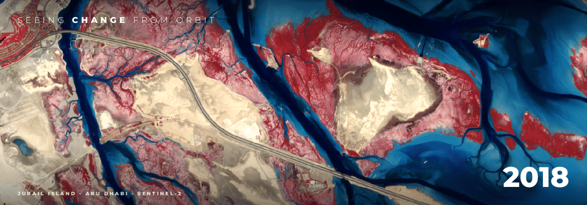
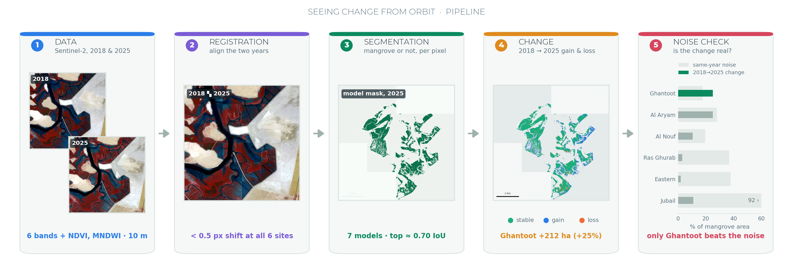
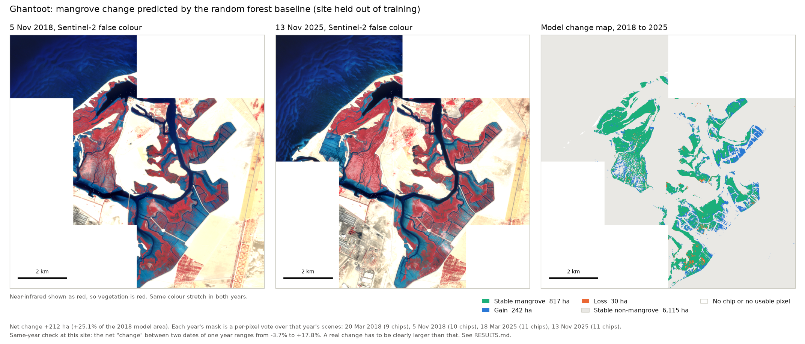

<p align="center">
  
</p>

<h1 align="center">Seeing Change from Orbit</h1>

<p align="center">
  <b>Detecting Coastal and Urban Change over Abu Dhabi from Satellite Imagery</b><br>
  Senior Design Project, Khalifa University<br>
  Supervisor: Dr. Panagiotis Liatsis, Department of Computer Science
</p>

<p align="center">
  
  
  
  
</p>

## Overview

Satellites revisit the same stretch of coast and city again and again, which makes it possible to compare two pictures of one place taken at different times and ask what has really changed. The hard part is telling meaningful change, such as new building or the advance and retreat of mangroves along the shore, apart from the many differences that mean nothing, such as tides, the time of year, cloud and shifting light.

This project builds a change detection system for Abu Dhabi's coast, with a focus on mangroves. Mangroves hold a great deal of carbon and sit at the centre of the UAE's Net Zero 2050 goal and of coastal resilience, so showing whether they are growing or shrinking is itself a change detection problem.

All data and tools are freely available. We use Sentinel-2 imagery from the European Copernicus programme, line up images from 2018 and 2025, compare segmentation models ranging from simple baselines to the DINOv3 foundation model with LoRA tuning, and measure how much of the detected change is real rather than noise.

## Pipeline

<p align="center">
  
</p>

## How it works

1. **Data.** Sentinel-2 Level-2A images of six mangrove sites on the Abu Dhabi coast (Eastern Mangroves, Jubail Island, Ras Ghurab, Ghantoot, Al Aryam Islands, Al Nouf), from 2018, 2020 and 2025. Each pixel has 6 bands (blue, green, red, near-infrared, two shortwave infrared) plus NDVI and MNDWI, at 10 m. Training labels come from Global Mangrove Watch (2020).
2. **Registration.** Before comparing years, we check that the 2018 and 2025 images line up. Landmarks are matched with SIFT and filtered with RANSAC, and a second check without landmarks uses phase correlation.
3. **Segmentation.** Each image is classified into mangrove or not, pixel by pixel. We compare an NDVI rule, a random forest, SVMs, a U-Net and the DINOv3 foundation model (frozen and with LoRA), using leave-one-site-out cross-validation so every score is on a site the model has never seen. We also test how small the U-Net can get before it loses accuracy.
4. **Change detection.** Several image dates from each year are combined into one map, using the same months in both years, and the 2018 and 2025 maps of each site are compared to give gain and loss in hectares.
5. **Noise check.** The same comparison between two images of the same year shows how much "change" the images and model produce on their own. A 2018 to 2025 change only counts if it is bigger than that.

## Results

| | Result | Details |
|---|---|---|
| **Registration** | 2018 and 2025 images line up to within half a pixel (under 5 m) at all 6 sites, so no correction is needed. Two unrelated methods (SIFT landmarks and phase correlation) agree. | [SIFT](results/registration/eastern_mangroves/RESULTS.md) · [phase correlation](results/registration/phase_correlation/RESULTS.md) |
| **Segmentation** | Random forest, SVM, U-Net and DINOv3 all tie at about 0.70 IoU against Global Mangrove Watch. The simple NDVI rule gets 0.60. | [Model comparison](results/mangrove_segmentation/model_comparison/RESULTS.md) |
| **Efficiency** | A U-Net with a quarter of the parameters (1.9M) matches the full one (0.699 vs 0.709 IoU) with half the GPU memory. | [Efficiency study](results/mangrove_segmentation/efficiency/RESULTS.md) |
| **Hand labels** | Four people labelled the same 6 chips and agree with each other at 0.72–0.83 IoU. GMW scores 0.70–0.75 against each of them, slightly below human agreement. Against the people's majority label, the random forest (0.86) and U-Net (0.82) score higher than GMW (0.74). | [Hand labels](results/mangrove_segmentation/hand_labels/RESULTS.md) |
| **Steadiness** | RF and SVM vary the least across image dates. U-Net and DINOv3 all drop on the same image (Al Aryam, 12 Nov 2020). | [Across dates](results/mangrove_segmentation/date_stability/RESULTS.md) |
| **Change** | Using the same months in both years, Ghantoot gained about +8% to +17% mangrove area from 2018 to 2025 and Ras Ghurab +6% to +21%. Eastern Mangroves and Jubail are unclear. These are early results, not yet checked against independent labels. | [Change maps](results/change_detection/RESULTS.md) · [fusion window check](results/change_detection/fusion_window/RESULTS.md) |

Every study, with what it found and what it means: [results/README.md](results/README.md).

<p align="center">
  
  <br><sub>Ghantoot: 2018, 2025 and the first-pass change map from the random forest.</sub>
</p>

## Learn more

Each step has its own write-up with the full method, numbers and figures. [results/README.md](results/README.md) summarises all of them.

| Step | Write-ups |
| --- | --- |
| **Data** | [Data sources](data/README.md) · [data dictionary](data/DATA_DICTIONARY.md) · [download and prep](src/mangrove_segmentation/README.md) · [hand labels](data/hand_labels/README.md) |
| **Registration** | [Overview](src/registration/README.md) · [landmark detection](docs/LANDMARK_DETECTION.md) · [alignment method](docs/REGISTRATION_METHOD.md) · [SIFT landmarks](results/registration/eastern_mangroves/RESULTS.md) · [phase correlation](results/registration/phase_correlation/RESULTS.md) · [different tides](results/registration/different_tides/RESULTS.md) · [Al Aryam](results/registration/al_aryam/RESULTS.md) |
| **Segmentation** | [Code](src/mangrove_segmentation/README.md) · [baselines](results/mangrove_segmentation/baselines/RESULTS.md) · [SVM](results/mangrove_segmentation/svm/RESULTS.md) · [U-Net](results/mangrove_segmentation/unet/RESULTS.md) · [DINOv3](results/mangrove_segmentation/dinov3/RESULTS.md) · [DINOv3 LoRA](results/mangrove_segmentation/dinov3_lora/RESULTS.md) · [U-Net report (PDF)](docs/reports/Seeing_Orbit_Mangrove_U-Net_Report.pdf) |
| **Model evaluation** | [Model comparison](results/mangrove_segmentation/model_comparison/RESULTS.md) · [where models disagree](results/mangrove_segmentation/model_disagreement/RESULTS.md) · [across dates](results/mangrove_segmentation/date_stability/RESULTS.md) · [multi-date vote](results/mangrove_segmentation/multi_date_vote/RESULTS.md) · [efficiency](results/mangrove_segmentation/efficiency/RESULTS.md) · [RGB only](results/mangrove_segmentation/rgb_only/RESULTS.md) · [how sure we are](results/mangrove_segmentation/confidence/RESULTS.md) · [against hand labels](results/mangrove_segmentation/hand_labels/RESULTS.md) |
| **Change detection** | [Code](src/change_detection/README.md) · [change maps](results/change_detection/RESULTS.md) · [U-Net noise check](results/change_detection/unet/RESULTS.md) · [date effect](results/change_detection/date_effect/RESULTS.md) · [fusion window check](results/change_detection/fusion_window/RESULTS.md) · [new bare or built ground](results/change_detection/human_activity/RESULTS.md) |
| **Project records** | [Proposal (PDF)](docs/proposal/SDP_Proposal_Seeing_Change_from_Orbit.pdf) · [project plan](docs/PROJECT_PLAN.md) · [progress log](docs/PROGRESS.md) · [meeting minutes](docs/meetings/README.md) · [final deliverables](docs/final/README.md) · [docs index](docs/README.md) |

## Setup and running

Python 3.11. Satellite images are not stored in Git. [Getting the data](data/README.md#getting-the-data) explains how to rebuild them.

```bash
# main environment: data prep, segmentation and change detection
conda env create -f src/mangrove_segmentation/environment.yml
conda activate mangrove
pip install torch    # or the CUDA build from pytorch.org

# extras
pip install -r src/registration/requirements.txt                          # registration
pip install -r src/mangrove_segmentation/dinov3/requirements_dinov3.txt   # DINOv3 only

# tests (from the repository root)
pytest src/registration/tests src/mangrove_segmentation/tests
```

Most analysis scripts take `--train-val <Train_Val_Dataset>` and `--out <folder>`. Keep the output folder outside the repository. The exact commands for each step are in its write-up, linked above.

## Repository layout

```
├── src/
│   ├── registration/            # align 2018 and 2025
│   ├── mangrove_segmentation/   # train and score the models
│   └── change_detection/        # gain and loss maps
├── results/                     # one RESULTS.md per experiment
├── data/                        # hand labels and test chips
└── docs/                        # proposal, plan, minutes, reports
    └── final/                   # final report, slides and demo
```

## Team

| Name | Student ID |
|---|---|
| Tehsin Shaik | 100064806 |
| Ayesha Almheiri | 100062972 |
| Zain Yamin | 100064796 |
| Zayed Alnaaebi | 100060474 |
| Khaled Alzaabi | 100060943 |

## Acknowledgements

- Supervised by Dr. Panagiotis Liatsis, Department of Computer Science, Khalifa University.
- Contains modified [Copernicus Sentinel-2](https://dataspace.copernicus.eu/explore-data/data-collections/sentinel-data/sentinel-2) data (2018 to 2025), accessed through [Earth Search](https://earth-search.aws.element84.com/v1) on AWS.
- Mangrove labels from [Global Mangrove Watch](https://www.globalmangrovewatch.org/).
- [DINOv3](https://github.com/facebookresearch/dinov3) foundation model by Meta AI.

## License

[MIT](LICENSE)
