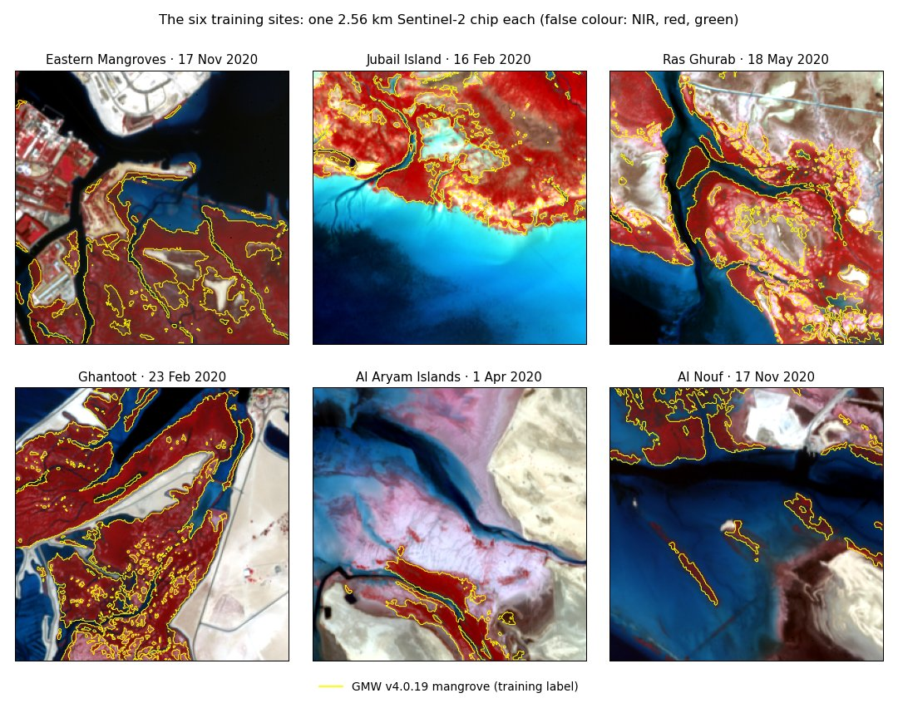

# Data

This folder contains the data dictionary and hand-labelled reference annotations. Large satellite images, generated datasets and model outputs are stored outside the repository to keep Git lightweight.

## In this folder

| Folder | What it holds |
| --- | --- |
| [`DATA_DICTIONARY.md`](DATA_DICTIONARY.md) | Every dataset, file, column and naming rule |
| [`hand_labels/`](hand_labels/README.md) | Mangrove outlines independently drawn by team members, used to evaluate GMW and model predictions against human interpretation |

## Sites

| Use | Sites |
| --- | --- |
| Training and cross-validation | Eastern Mangroves, Jubail Island, Ras Ghurab, Ghantoot, Al Aryam Islands, Al Nouf |
| Locked test | Abu Al Abyad, Marawah |
| Locked external test | Ras Al Khor, Al Zorah, Khor Al Beida, Ras Al Khaimah creek, Khor Kalba |

The six training sites are located in Abu Dhabi and are grouped into five cross-validation folds:

| Fold | Site |
| --- | --- |
| 1 | Eastern Mangroves |
| 2 | Jubail Island |
| 3 | Ras Ghurab |
| 4 | Ghantoot |
| 5 | Al Aryam Islands + Al Nouf |

Al Aryam Islands and Al Nouf share a fold because they are approximately 1.5 km apart. Each fold is held out entirely during its corresponding validation run. Locked test sites are excluded from training, model selection and hyperparameter tuning. Their data and reference labels are reserved for final evaluation.

## Satellite imagery

- **Source:** Sentinel-2 Level-2A surface reflectance, from the Earth Search v1 STAC collection `sentinel-2-c1-l2a` (public, no login).
- **Dates:** Eight acquisitions selected per site: four from 2020, two from 2018 (March and November) and two from 2025 (March and November).
- **Cloud:** filtered in two stages. First, scene selection keeps scenes with less than 10% scene-level cloud cover (the Sentinel-2 `eo:cloud_cover` value for the whole scene). Then, at the chip level, cloud and shadow are identified with the SCL band, and any chip with more than 5% cloud or shadow (or more than 10% no data) is dropped. A scene can pass the first stage and still give no usable chips if its clouds sit over the site.
- **Grid:** 10 m pixels in EPSG:32640 (UTM zone 40N), cut into 256 × 256 chips.
- **Model inputs:** 8 channels per chip: 6 downloaded Sentinel-2 bands and 2 indices calculated from them:

| Channel | Band | Description |
| --- | --- | --- |
| 0 to 3 | B02, B03, B04, B08 | Blue, green, red and near-infrared (10 m) |
| 4 to 5 | B11, B12 | Shortwave infrared (20 m, resampled to 10 m) |
| 6 | NDVI | Normalised Difference Vegetation Index |
| 7 | MNDWI | Modified Normalised Difference Water Index |

## Labels

- **Global Mangrove Watch (GMW):** a publicly available global dataset mapping mangrove extent. Two releases are used across the datasets, and which one is available, and what it is used for, depends on the acquisition year:
  - **v4.0.19** (10 m, 2020 only): the training label, and the reference for cross-validation scores.
  - **v4.1.12** (~30 m, 2018, 2020 and 2025): used as a secondary reference on 2020 chips and as the reference for 2018 and 2025 change mapping.

  On the 2020 chips, where both releases are available, their mangrove masks have a pooled IoU of 0.67 over all 215 chips. On the six hand-labelled chips, using the same pixels and the same pooled method, the two releases agree at 0.80 and the two human annotators at 0.69. This highlights variability in the reference data and motivates using independent hand labels to evaluate both GMW and model predictions.
- **Hand labels:** Independently drawn mangrove annotations used to assess agreement between GMW, model predictions and human interpretation. See [`hand_labels/`](hand_labels/README.md).

## Getting the data

The scripts in [`src/mangrove_segmentation`](../src/mangrove_segmentation/README.md) rebuild the datasets:

1. `collect.py` downloads the Sentinel-2 images for each site and date.
2. `prepare.py` cuts them into chips and adds the GMW masks.
3. `make_datasets.py` writes `Train_Val_Dataset` and the locked `Test_Dataset`.

The other scripts read `Train_Val_Dataset` through `--train-val`. Keep it and all outputs outside the repository.

## Rules

- Don't commit satellite images, dataset archives, model weights or credentials.
- Do commit small labels, metadata, checksums and the code that makes the data.
- Don't train or tune on locked test sites.
