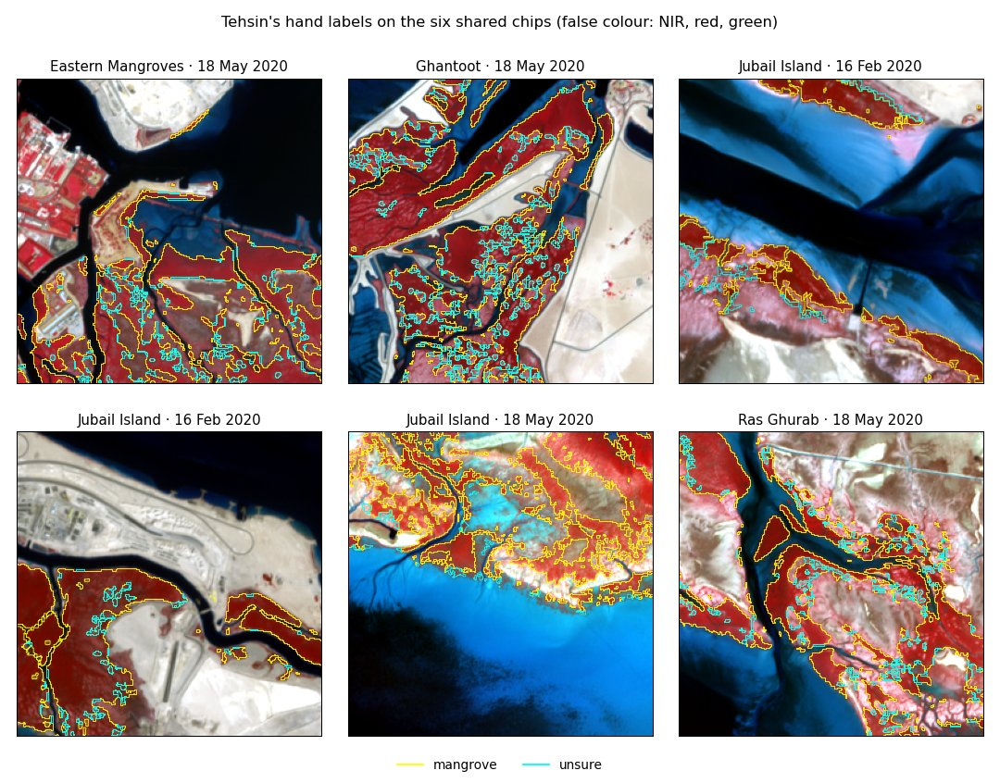
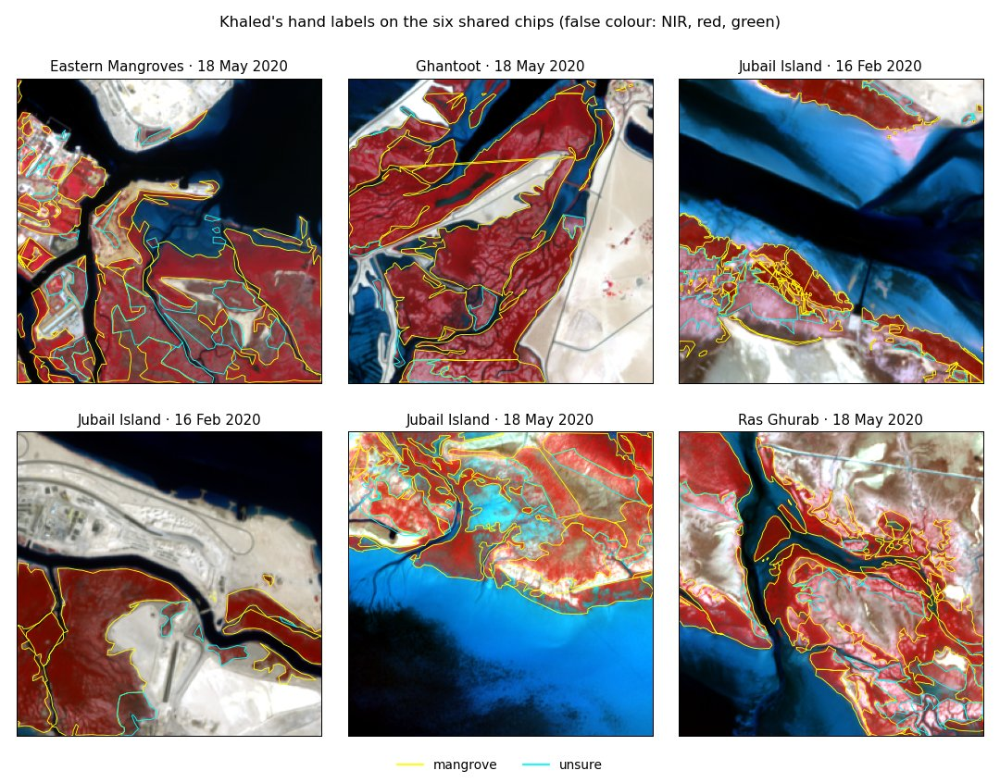
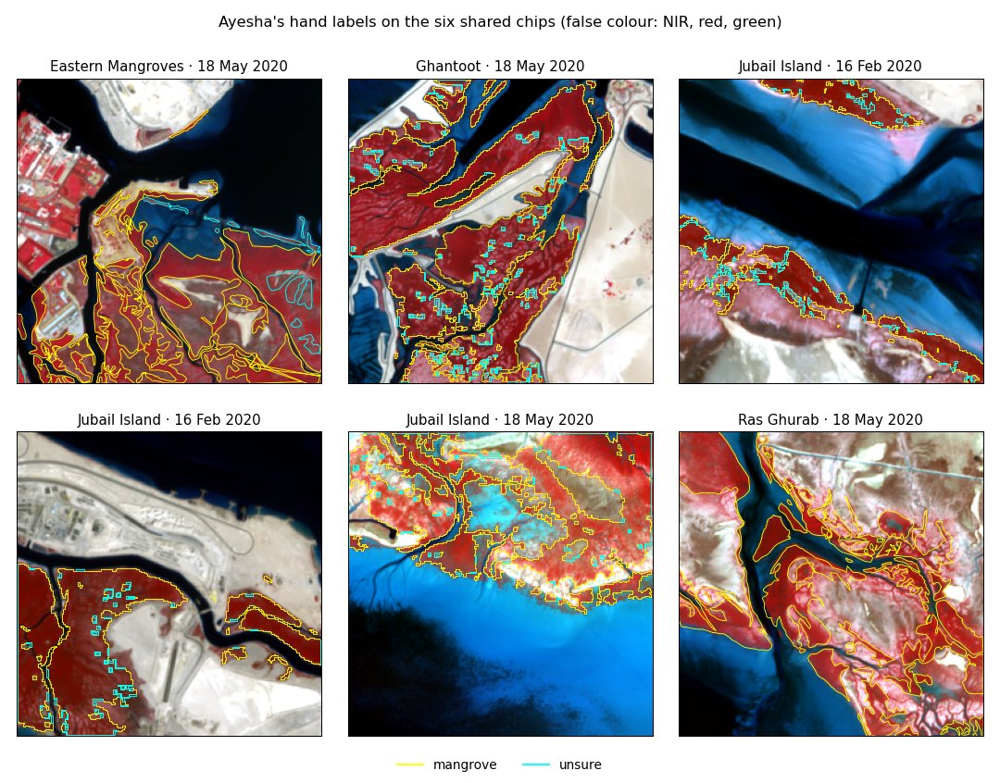
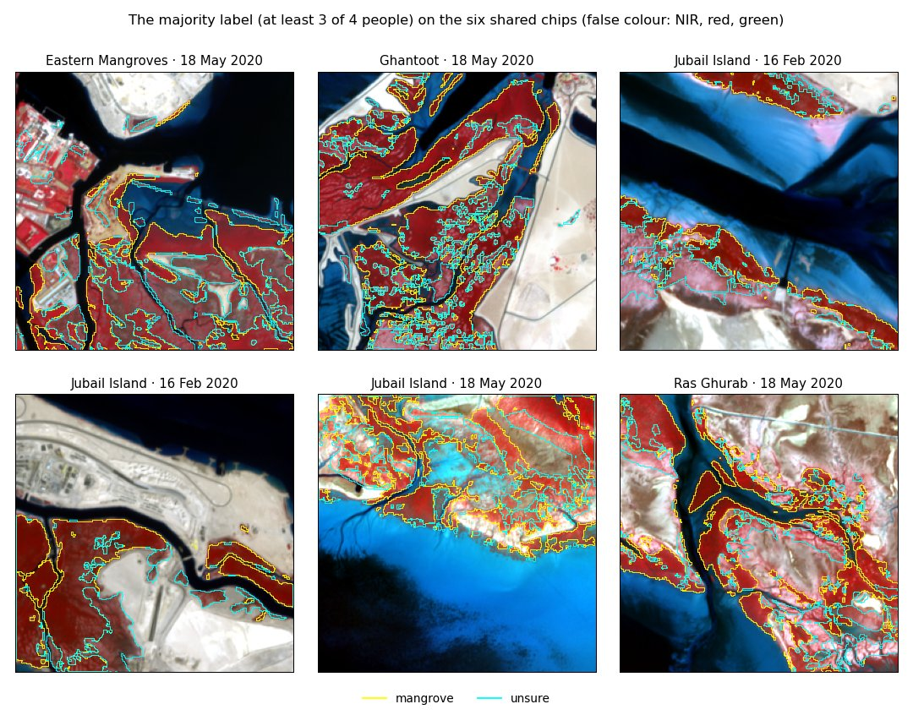

# Hand labels

Mangrove canopy outlines manually delineated on individual 256 × 256 pixel chips (2.56 km × 2.56 km at 10 m resolution). They provide an independent visual reference for comparing GMW classifications and model predictions with human interpretation of the imagery. They are manually interpreted reference labels, not ground truth. All files are GeoPackages in EPSG:32640.

## Files

| File | Labeller | Site | Image date | Chip | CV fold | `mangrove` | `unsure` |
| --- | --- | --- | --- | --- | --- | --- | --- |
| [`Tehsin/eastern_mangroves_2020-05-18_r00256_c00256_Tehsin.gpkg`](Tehsin/eastern_mangroves_2020-05-18_r00256_c00256_Tehsin.gpkg) | Tehsin | Eastern Mangroves | 18 May 2020 | `r00256_c00256` | 1 | 96 polygons, 122.0 ha | 123 polygons, 2.1% of chip |
| [`Khaled/eastern_mangroves_2020-05-18_r00256_c00256_Khaled.gpkg`](Khaled/eastern_mangroves_2020-05-18_r00256_c00256_Khaled.gpkg) | Khaled | Eastern Mangroves | 18 May 2020 | `r00256_c00256` | 1 | 36 polygons, 180.8 ha | 26 polygons, 9.2% of chip |
| [`Zain/eastern_mangroves_2020-05-18_r00256_c00256_Zain.gpkg`](Zain/eastern_mangroves_2020-05-18_r00256_c00256_Zain.gpkg) | Zain | Eastern Mangroves | 18 May 2020 | `r00256_c00256` | 1 | 109 polygons, 167.3 ha | 29 polygons, 11.6% of chip |
| [`Tehsin/ghantoot_2020-05-18_r00256_c00256_Tehsin.gpkg`](Tehsin/ghantoot_2020-05-18_r00256_c00256_Tehsin.gpkg) | Tehsin | Ghantoot | 18 May 2020 | `r00256_c00256` | 4 | 188 polygons, 191.2 ha | 216 polygons, 4.6% of chip |
| [`Khaled/ghantoot_2020-05-18_r00256_c00256_Khaled.gpkg`](Khaled/ghantoot_2020-05-18_r00256_c00256_Khaled.gpkg) | Khaled | Ghantoot | 18 May 2020 | `r00256_c00256` | 4 | 19 polygons, 274.2 ha | 8 polygons, 2.4% of chip |
| [`Zain/ghantoot_2020-05-18_r00256_c00256_Zain.gpkg`](Zain/ghantoot_2020-05-18_r00256_c00256_Zain.gpkg) | Zain | Ghantoot | 18 May 2020 | `r00256_c00256` | 4 | 166 polygons, 243.5 ha | 26 polygons, 2.6% of chip |
| [`Tehsin/jubail_island_2020-02-16_r00256_c00768_Tehsin.gpkg`](Tehsin/jubail_island_2020-02-16_r00256_c00768_Tehsin.gpkg) | Tehsin | Jubail Island | 16 Feb 2020 | `r00256_c00768` | 2 | 35 polygons, 64.2 ha | 24 polygons, 1.2% of chip |
| [`Khaled/jubail_island_2020-02-16_r00256_c00768_Khaled.gpkg`](Khaled/jubail_island_2020-02-16_r00256_c00768_Khaled.gpkg) | Khaled | Jubail Island | 16 Feb 2020 | `r00256_c00768` | 2 | 78 polygons, 89.0 ha | 19 polygons, 5.2% of chip |
| [`Zain/jubail_island_2020-02-16_r00256_c00768_Zain.gpkg`](Zain/jubail_island_2020-02-16_r00256_c00768_Zain.gpkg) | Zain | Jubail Island | 16 Feb 2020 | `r00256_c00768` | 2 | 194 polygons, 98.2 ha | 0 polygons, 0.0% of chip |
| [`Tehsin/jubail_island_2020-02-16_r01024_c00000_Tehsin.gpkg`](Tehsin/jubail_island_2020-02-16_r01024_c00000_Tehsin.gpkg) | Tehsin | Jubail Island | 16 Feb 2020 | `r01024_c00000` | 2 | 18 polygons, 125.8 ha | 49 polygons, 1.0% of chip |
| [`Khaled/jubail_island_2020-02-16_r01024_c00000_Khaled.gpkg`](Khaled/jubail_island_2020-02-16_r01024_c00000_Khaled.gpkg) | Khaled | Jubail Island | 16 Feb 2020 | `r01024_c00000` | 2 | 8 polygons, 153.4 ha | 5 polygons, 2.2% of chip |
| [`Zain/jubail_island_2020-02-16_r01024_c00000_Zain.gpkg`](Zain/jubail_island_2020-02-16_r01024_c00000_Zain.gpkg) | Zain | Jubail Island | 16 Feb 2020 | `r01024_c00000` | 2 | 32 polygons, 131.0 ha | 8 polygons, 4.7% of chip |
| [`Tehsin/jubail_island_2020-05-18_r01024_c01024_Tehsin.gpkg`](Tehsin/jubail_island_2020-05-18_r01024_c01024_Tehsin.gpkg) | Tehsin | Jubail Island | 18 May 2020 | `r01024_c01024` | 2 | 105 polygons, 126.5 ha | 27 polygons, 0.6% of chip |
| [`Khaled/jubail_island_2020-05-18_r01024_c01024_Khaled.gpkg`](Khaled/jubail_island_2020-05-18_r01024_c01024_Khaled.gpkg) | Khaled | Jubail Island | 18 May 2020 | `r01024_c01024` | 2 | 24 polygons, 172.2 ha | 12 polygons, 4.8% of chip |
| [`Zain/jubail_island_2020-05-18_r01024_c01024_Zain.gpkg`](Zain/jubail_island_2020-05-18_r01024_c01024_Zain.gpkg) | Zain | Jubail Island | 18 May 2020 | `r01024_c01024` | 2 | 133 polygons, 120.9 ha | 65 polygons, 4.3% of chip |
| [`Tehsin/ras_ghurab_2020-05-18_r00768_c00512_Tehsin.gpkg`](Tehsin/ras_ghurab_2020-05-18_r00768_c00512_Tehsin.gpkg) | Tehsin | Ras Ghurab | 18 May 2020 | `r00768_c00512` | 3 | 197 polygons, 140.4 ha | 142 polygons, 2.7% of chip |
| [`Khaled/ras_ghurab_2020-05-18_r00768_c00512_Khaled.gpkg`](Khaled/ras_ghurab_2020-05-18_r00768_c00512_Khaled.gpkg) | Khaled | Ras Ghurab | 18 May 2020 | `r00768_c00512` | 3 | 43 polygons, 173.6 ha | 22 polygons, 7.2% of chip |
| [`Zain/ras_ghurab_2020-05-18_r00768_c00512_Zain.gpkg`](Zain/ras_ghurab_2020-05-18_r00768_c00512_Zain.gpkg) | Zain | Ras Ghurab | 18 May 2020 | `r00768_c00512` | 3 | 289 polygons, 146.6 ha | 55 polygons, 1.5% of chip |
| [`Ayesha/eastern_mangroves_2020-05-18_r00256_c00256_Ayesha.gpkg`](Ayesha/eastern_mangroves_2020-05-18_r00256_c00256_Ayesha.gpkg) | Ayesha | Eastern Mangroves | 18 May 2020 | `r00256_c00256` | 1 | 30 polygons, 138.6 ha | 13 polygons, 1.8% of chip |
| [`Ayesha/ghantoot_2020-05-18_r00256_c00256_Ayesha.gpkg`](Ayesha/ghantoot_2020-05-18_r00256_c00256_Ayesha.gpkg) | Ayesha | Ghantoot | 18 May 2020 | `r00256_c00256` | 4 | 27 polygons, 233.4 ha | 127 polygons, 1.7% of chip |
| [`Ayesha/jubail_island_2020-02-16_r00256_c00768_Ayesha.gpkg`](Ayesha/jubail_island_2020-02-16_r00256_c00768_Ayesha.gpkg) | Ayesha | Jubail Island | 16 Feb 2020 | `r00256_c00768` | 2 | 46 polygons, 69.5 ha | 63 polygons, 1.1% of chip |
| [`Ayesha/jubail_island_2020-02-16_r01024_c00000_Ayesha.gpkg`](Ayesha/jubail_island_2020-02-16_r01024_c00000_Ayesha.gpkg) | Ayesha | Jubail Island | 16 Feb 2020 | `r01024_c00000` | 2 | 10 polygons, 129.1 ha | 53 polygons, 0.9% of chip |
| [`Ayesha/jubail_island_2020-05-18_r01024_c01024_Ayesha.gpkg`](Ayesha/jubail_island_2020-05-18_r01024_c01024_Ayesha.gpkg) | Ayesha | Jubail Island | 18 May 2020 | `r01024_c01024` | 2 | 30 polygons, 168.8 ha | 52 polygons, 0.8% of chip |
| [`Ayesha/ras_ghurab_2020-05-18_r00768_c00512_Ayesha.gpkg`](Ayesha/ras_ghurab_2020-05-18_r00768_c00512_Ayesha.gpkg) | Ayesha | Ras Ghurab | 18 May 2020 | `r00768_c00512` | 3 | 39 polygons, 163.2 ha | 0 polygons, 0.0% of chip |

Each file name is the chip id from `catalog.csv` plus the labeller's name, so it maps to exactly one chip in Train_Val_Dataset. Polygon counts indicate the number of features in each layer. Mangrove areas are reported in hectares; unsure areas are reported as a percentage of the chip area (655.36 ha), because unsure pixels are left out of scoring and the percentage shows how much of the chip each labeller's `unsure` layer removes. Overlapping polygons are counted once when calculating area.

## Majority ground truth

The four people's labels are merged into one ground truth per chip in [`majority/`](majority/). A pixel is `mangrove` if at least three of the four people marked it, and `unsure` if any of them put it in `unsure`. Cloud and no-data pixels are left out of both. The polygons follow the 10 m pixel grid of the chip, so their edges are stepped.

| File | Site | Image date | `mangrove` | `unsure` |
| --- | --- | --- | --- | --- |
| [`majority/eastern_mangroves_2020-05-18_r00256_c00256_majority.gpkg`](majority/eastern_mangroves_2020-05-18_r00256_c00256_majority.gpkg) | Eastern Mangroves | 18 May 2020 | 51 polygons, 106.0 ha | 18.3% of chip |
| [`majority/ghantoot_2020-05-18_r00256_c00256_majority.gpkg`](majority/ghantoot_2020-05-18_r00256_c00256_majority.gpkg) | Ghantoot | 18 May 2020 | 164 polygons, 194.8 ha | 9.5% of chip |
| [`majority/jubail_island_2020-02-16_r00256_c00768_majority.gpkg`](majority/jubail_island_2020-02-16_r00256_c00768_majority.gpkg) | Jubail Island | 16 Feb 2020 | 33 polygons, 66.8 ha | 7.1% of chip |
| [`majority/jubail_island_2020-02-16_r01024_c00000_majority.gpkg`](majority/jubail_island_2020-02-16_r01024_c00000_majority.gpkg) | Jubail Island | 16 Feb 2020 | 16 polygons, 117.5 ha | 6.3% of chip |
| [`majority/jubail_island_2020-05-18_r01024_c01024_majority.gpkg`](majority/jubail_island_2020-05-18_r01024_c01024_majority.gpkg) | Jubail Island | 18 May 2020 | 108 polygons, 107.0 ha | 9.6% of chip |
| [`majority/ras_ghurab_2020-05-18_r00768_c00512_majority.gpkg`](majority/ras_ghurab_2020-05-18_r00768_c00512_majority.gpkg) | Ras Ghurab | 18 May 2020 | 154 polygons, 126.6 ha | 10.2% of chip |

They are made by `label_agreement.py --save-majority` (see below). Needing three of four votes makes the majority a little tighter than most single labellers. The `agreed` and `union` labels are scored in the [hand-label results](../../results/mangrove_segmentation/hand_labels/RESULTS.md) but not saved.

## Additional hand label: Khor Al Beida

[`Tehsin/KAB_2020_07.gpkg`](Tehsin/KAB_2020_07.gpkg) contains a separate manual annotation of chip `KAB_2020_07`, a 2020 Sentinel-2 chip of Khor Al Beida. The chip itself is not in this repository and is not part of Train_Val. The file contains 24 mangrove polygons covering 119.5 ha and no unsure polygons. A preview is provided in [`Tehsin/KAB_2020_07_preview.png`](Tehsin/KAB_2020_07_preview.png). This annotation is separate from the six shared Train_Val chips and is not included in the hand-label scoring comparison.

## Layers

- `mangrove`: confident mangrove canopy, deep red in a false-colour image (near-infrared, red, green).
- `unsure`: mixed pixels at canopy edges that could go either way. Leave these out of any score.
- Pixels outside both the `mangrove` and `unsure` polygons are treated as non-mangrove for scoring, including water, sand, wet mud, saltmarsh and man-made structures. Cloud and no-data pixels, and pixels that any labeller marked `unsure`, are left out, so every comparison on a chip uses the same pixels. The target class is specifically mangrove canopy, rather than vegetation in general.

## Using them

- The labelling instructions ask each person to independently annotate the same chips without looking at GMW data, model predictions or other labellers' annotations. Comparing independently drawn labels helps quantify inter-annotator agreement and understand the uncertainty associated with manual interpretation of mangrove boundaries.
- The models use site-grouped cross-validation, with all chips from a site held out together. Each hand-labelled chip is evaluated using predictions from the fold model that did not train on that chip's site: the random forest is retrained for the chip's held-out fold, and the U-Net predictions come from its model for that fold. Consequently, the hand-label comparisons use out-of-fold predictions rather than predictions from models trained on the same sites. These are cross-validation results, not final test-set results.
- [`src/mangrove_segmentation/label_agreement.py`](../../src/mangrove_segmentation/label_agreement.py) compares labellers and scores GMW and the models against these files. With three or more labellers it also builds a `majority` label (mangrove where more than half of them agree, so at least three of the four). Results are in [results/mangrove_segmentation/hand_labels](../../results/mangrove_segmentation/hand_labels/RESULTS.md).
