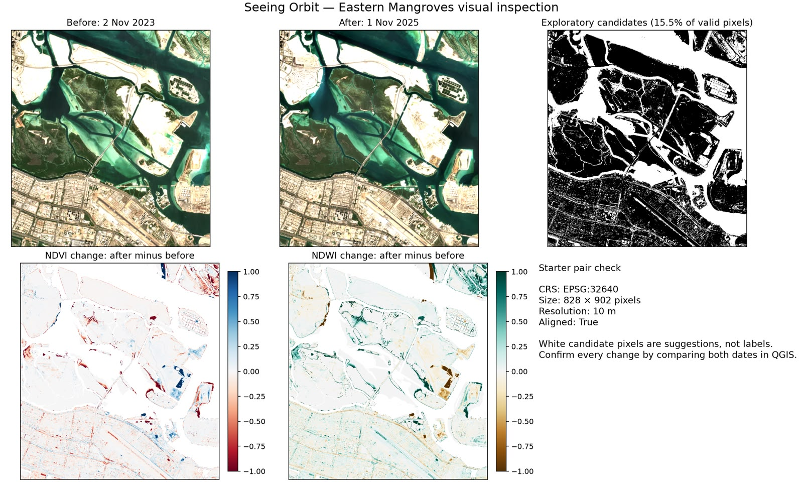

# Progress Log

This log records concrete project outputs and unresolved limitations. Detailed implementation should remain reproducible through scripts or notebooks committed alongside later experiments.

## 30 September 2026

### Eastern Mangroves Exploratory Comparison

- Compared imagery from 2 November 2023 and 1 November 2025.
- Generated NDVI and NDWI difference maps.
- Produced an exploratory candidate-change mask covering 15.5% of valid pixels.
- Used an EPSG:32640 grid with 10 m pixels and an output size of 828 by 902 pixels.
- Confirmed that the two raster arrays share a common grid.

The candidate mask is not a ground-truth label. It includes possible mangrove change as well as potential effects from water boundaries, tide, seasonal appearance, illumination, residual misregistration, and other land-cover changes. Every candidate area requires comparison against both dates and geographic review in QGIS.

`Aligned: True` in the figure means the rasters share a compatible grid. Formal registration still needs to be evaluated using fixed landmarks or independent control points and a reported spatial error.

## 3 October 2026

### Six-Band Sentinel-2 Exports

- Exported six-band Sentinel-2 GeoTIFFs named for 10 December 2018 and 10 December 2025 over Eastern Mangroves; their acquisition metadata still needs to be verified.
- Kept the full raster files outside Git and recorded their filenames, sizes, and SHA-256 checksums in the data documentation.
- Confirmed that the 2018-2025 pair is separate from the earlier 2023-2025 exploratory figure.

### Research and Planning

- Reviewed remote-sensing segmentation and change-detection methods, including SAM-based approaches, U-Net, DECDNet, and classical random forest or SVM baselines.
- Defined QGIS as the quality-control, registration-checking, annotation, validation, and map-production environment rather than the model-training environment.
- Assigned initial responsibilities for registration, segmentation baselines, multispectral exports, and ground-truth investigation.

## 4 October 2026

### Landmark Detection

- Compared landmark detectors for matching Sentinel-2 images across dates (Khaled). See [LANDMARK_DETECTION.md](LANDMARK_DETECTION.md).

## 9 November 2026

### Segmentation Pipeline and First Models

- Added the mangrove segmentation pipeline: image download with the Sentinel-2 offset applied once, 256 x 256 chips, GMW labels and a catalog (Ayesha). See [src/mangrove_segmentation](../src/mangrove_segmentation/).
- Set up leave-one-site-out cross-validation on the 2020 chips: 215 chips, 6 Abu Dhabi sites, 5 folds. The Test_Dataset stays closed.
- First results: NDVI + MNDWI rule, random forest, U-Net and frozen DINOv3. The random forest set the bar at 0.70 mean IoU. See [baselines](../results/mangrove_segmentation/baselines/RESULTS.md), [U-Net](../results/mangrove_segmentation/unet/RESULTS.md) and [DINOv3](../results/mangrove_segmentation/dinov3/RESULTS.md).

## 13 November 2026

- Added the U-Net report and the Seeing Orbit test-chip inputs (Zayed). See [reports](reports/).
- Added a hand-drawn mangrove outline for a Khor Al Beida chip, `KAB_2020_07` (Tehsin). See [data/hand_labels](../data/hand_labels/).

## 16 November 2026

- Added the project proposal, the [data dictionary](../data/DATA_DICTIONARY.md) and DINOv3 LoRA fine-tuning code (Zain).
- Added the image alignment method (Tehsin). SIFT landmarks with RANSAC, similarity and affine fits, and a transform is only applied if it lowers the held-out RMSE by at least 1 m. At Jubail the error with no correction is about 5 m, half a pixel, so no correction was needed. The method also compares 2 and 3 landmarks. See [REGISTRATION_METHOD.md](REGISTRATION_METHOD.md).

## 18 November 2026

### More Models

- SVM baseline, linear and approximate RBF (Zain). See [svm](../results/mangrove_segmentation/svm/RESULTS.md).
- DINOv3 with LoRA, 80 epochs: 0.694 mean IoU, not above the random forest (Zain). See [dinov3_lora](../results/mangrove_segmentation/dinov3_lora/RESULTS.md).
- Where all three of RF, SVM and LoRA disagree with GMW, mostly on GMW edges (Zain). See [model_disagreement](../results/mangrove_segmentation/model_disagreement/RESULTS.md).
- Voting over the 2020 dates of each chip raises the random forest from 0.714 to 0.752 IoU (Zain). See [multi_date_vote](../results/mangrove_segmentation/multi_date_vote/RESULTS.md).

### Registration Checks

- The alignment method was run again, unchanged, at Eastern Mangroves and on pairs taken at different tides (Zain). The error stayed at about 5 to 6 m and no correction was needed. See [eastern_mangroves](../results/registration/eastern_mangroves/RESULTS.md) and [different_tides](../results/registration/different_tides/RESULTS.md).

### First Change Maps

- 2018 to 2025 change maps per site with the random forest, checked against the swing between two dates of the same year (Zain). At five of six sites the change is not bigger than that swing, so the maps are not yet reliable. See [change_detection](../results/change_detection/RESULTS.md).
- The U-Net is not steadier across dates than the random forest (Zain). See [unet](../results/change_detection/unet/RESULTS.md).
- New bare or built ground near the mangroves at Jubail Island and Ghantoot (Zain). See [human_activity](../results/change_detection/human_activity/RESULTS.md).

## 19 to 21 November 2026

### Model Choice

- Paired comparison of all models across the 5 folds (Tehsin). RF, SVM (approx. RBF), U-Net, frozen DINOv3 and DINOv3 LoRA are tied: the largest gap is 0.018 IoU, against about 0.30 between the easiest and hardest site. Under the rule of taking the simpler model on a tie, the pick is RF or SVM. See [model_comparison](../results/mangrove_segmentation/model_comparison/RESULTS.md).
- U-Net efficiency study (Tehsin, GPU runs by Zain). Base 16 keeps 0.699 IoU with a quarter of the parameters. Base 4 drops to 0.616. See [efficiency](../results/mangrove_segmentation/efficiency/RESULTS.md).
- How much each model's score moves between image dates (Tehsin). RF and SVM move less than the U-Net and DINOv3. See [date_stability](../results/mangrove_segmentation/date_stability/RESULTS.md).

### Why the Same-Year Swings Happen

- Tide explains about 1% of the swing, differences between the images go with about half of it, and nothing tested makes the model steady (Zain). See [date_effect](../results/change_detection/date_effect/RESULTS.md).

### Registration Cross-Check

- Phase correlation, a method that does not use landmarks, measured the shift at all six sites (Tehsin). The shifts are small. The largest is the Al Aryam March pair, at about 4.5 m and mostly north. See [phase_correlation](../results/registration/phase_correlation/RESULTS.md).
- Al Aryam was then registered and its change map redone (Tehsin). The shift removes about 3 ha of fake gain, but the net change is still within the same-year swing. See [al_aryam](../results/registration/al_aryam/RESULTS.md).

## 22 November 2026

### Hand Labels

- Added 6 chip labels to [data/hand_labels/Tehsin](../data/hand_labels/README.md): Jubail Island (3 chips), Ras Ghurab, Eastern Mangroves and Ghantoot (Tehsin).
- Compared Tehsin's labels with Khaled's on the same 6 chips, and scored GMW and the models against both (Tehsin). The two people agree at 0.687 IoU, and GMW scores 0.699 and 0.706 against them, so GMW is about as good as a second labeller. Khaled draws wider edges; the random forest is closest to Tehsin (0.845) and the U-Net to Khaled (0.742). See [hand_labels](../results/mangrove_segmentation/hand_labels/RESULTS.md).

## Next Steps

1. Decide how to merge the two people's labels into one ground truth: the agreed area or the union.
2. Choose between the random forest and the approximate RBF SVM, then run the Test_Dataset once.
3. Make change maps that hold up against the same-year swing, for example from multi-date votes or multi-month composites.
4. Write the SDP I report and prepare the demo.
