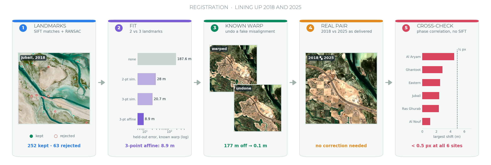
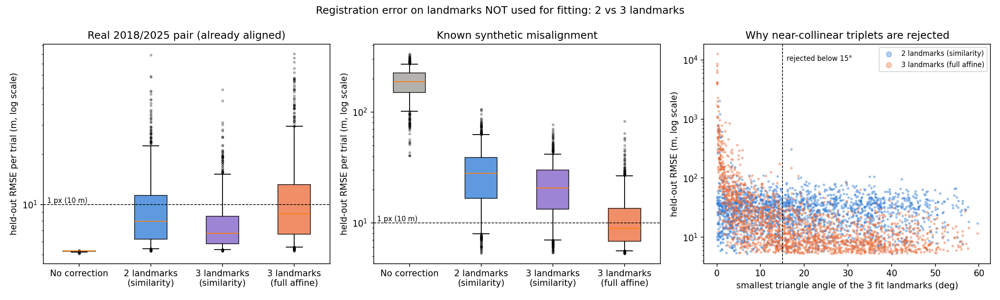
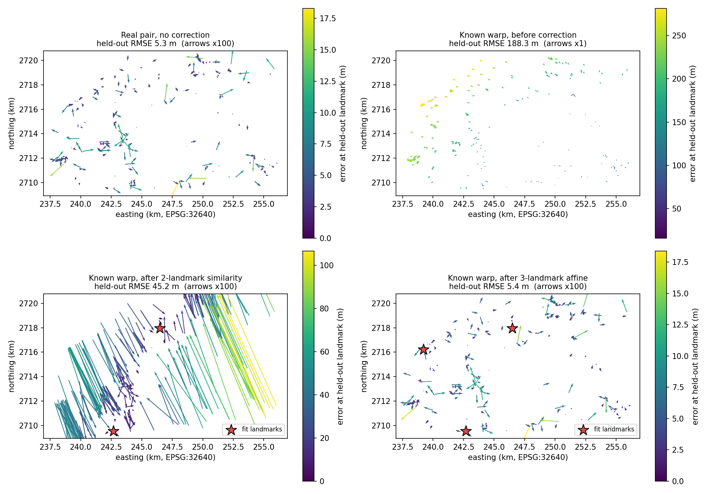
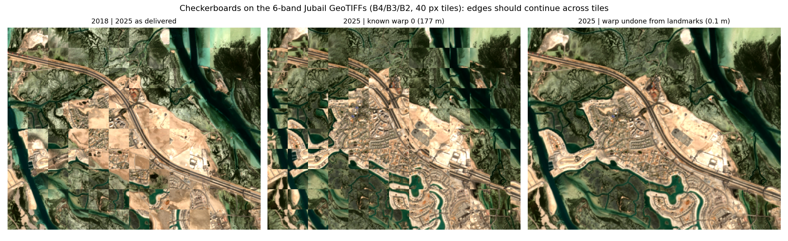

# Track A: Image Registration and Alignment

## Overview

This document describes the image registration and alignment component of Track A, implemented by Tehsin Shaik. It follows the landmark detection stage documented in [LANDMARK_DETECTION.md](LANDMARK_DETECTION.md), implemented by Khaled Alzaabi.

Khaled's module identifies corresponding landmarks between the 2018 and 2025 images. This module uses those correspondences to estimate geometric transformations, evaluate alignment accuracy on held-out landmarks, and determine whether the 2025 image requires correction.

<p align="center">
  
</p>

Main findings:

- **The Jubail 2018/2025 pair is already aligned.** With no correction, the held-out error is about 5 m (half a pixel), and no fitted transformation reduces it by the required 1 m, so no correction is applied.
- **Three landmarks are needed for a real correction.** On a known synthetic misalignment, a full affine fitted from 3 landmarks leaves a median error of 8.9 m, against 28.0 m for a similarity fitted from 2.
- **The shape of the landmark triangle matters.** Nearly collinear triplets produce errors of up to several kilometres and are rejected.
- **The raster warping works on real images.** Known warps of 151 to 236 m applied to the real 2025 GeoTIFF are recovered to within 0.11 to 0.16 m.

| | |
| --- | --- |
| Code | [`src/registration/affine_alignment.py`](../src/registration/affine_alignment.py), [`src/registration/real_raster_check.py`](../src/registration/real_raster_check.py) |
| Tests | [`src/registration/tests/test_affine_alignment.py`](../src/registration/tests/test_affine_alignment.py) |
| Results | [`results/registration/`](../results/registration/) |

## Why Registration Is Necessary

Change detection compares the same location on the ground in two years. If the 2025 image is shifted by even one pixel (10 m), every mangrove edge and shoreline appears as false change. Before the years can be compared, it is therefore necessary to measure how well the images line up and to correct them if needed.

## Transformation Models

Each landmark pair gives two equations, one for x and one for y.

| Landmarks | Equations | Transformation | Parameters corrected |
| --- | --- | --- | --- |
| 2 | 4 | Similarity | Translation, rotation, uniform scale |
| 3 non-collinear | 6 | Full affine | Translation, rotation, independent axis scaling, shear |

With 2 landmarks a full affine is not possible (4 equations, 6 unknowns), so the 2-landmark case uses a similarity. Three landmarks are sufficient for a full affine only when they are not on a line. If they are on a line or close to it, the fit becomes unstable. Triplets with a side shorter than 1 km or an angle smaller than 15° are therefore rejected. These thresholds are heuristic safeguards, not universal geometric requirements, and can be changed in the code (`MIN_SEPARATION_M`, `MIN_ANGLE_DEG`).

Every transformation maps 2025 coordinates (moving image) into the 2018 coordinate system (reference image).

## Alignment Error and Evaluation Design

- Coordinates are in EPSG:32640 (UTM zone 40N), measured in metres rather than pixels, because pixel positions depend on how each image was cropped.
- The transformation is estimated using a subset of landmark correspondences.
- Error is evaluated using correspondences excluded from the fit. Error on the fitted points is close to zero by construction, so it says nothing about how well the transformation generalises.
- For each held-out landmark, the error is the distance between the transformed 2025 point and its 2018 partner. RMSE is the square root of the mean of these squared distances.

Two evaluation designs are used:

1. **2 versus 3 landmarks.** Each trial picks 3 random landmarks, fits each method, and measures the error on all the other landmarks (about 249). The 2-landmark similarity uses the first two of the same three points, so both methods are compared on exactly the same draw and the same held-out points. 2,000 trials are run. Of these, 1,006 triplets pass the rejection rules on the real pair and 1,078 on the known warp.
2. **All landmarks.** Each model is fitted to all RANSAC inliers using 10-fold cross-validation: it is fitted on nine tenths of the landmarks and evaluated on the remaining tenth, ten times, so every landmark is scored by a model that did not use it. A correction is applied only if it lowers this held-out RMSE by at least 1 m compared with no correction.

The real pair turned out to be already aligned, so a **known warp** is also tested. The 2025 landmarks are moved by one of Khaled's random affine transformations (up to 150 m shift, ±2° rotation, ±2% scale and ±1% shear), and the method is checked on whether it undoes it.

The comparison between methods uses the paired difference in held-out RMSE on the same trials. Its 95% confidence interval comes from 5,000 bootstrap resamples of those paired differences. All random draws use a fixed seed (42), so the results can be reproduced exactly.

### Results on the landmark coordinates

**The real 10 December 2018 / 10 December 2025 pair is already aligned.** RANSAC keeps 252 of 315 matches. With no correction the held-out RMSE is 5.25 m, about half a pixel. Fitting a translation, similarity or affine on all landmarks gives 5.25 to 5.27 m in 10-fold cross-validation. The best model improves on no correction by only 0.003 m, so no correction is applied (`selected_transform.json`).

**2 versus 3 landmarks:**

| Method | Real pair (m) | Known warp (m) |
| --- | --- | --- |
| No correction | 5.3 | 187.6 |
| 2 landmarks, similarity | 7.9 | 28.0 |
| 3 landmarks, similarity | 6.7 | 20.7 |
| 3 landmarks, full affine | 8.8 | **8.9** |

Values represent median held-out RMSE across the accepted trials. The known-warp experiment introduces transformations containing translation, rotation, scale and shear.

- **When the misalignment includes shear, the full affine performs best.** Across paired trials, the full affine model reduces held-out RMSE relative to the 2-landmark similarity by a median of 16.1 m (95% confidence interval: 14.7–17.8 m), and achieves lower error in 89% of trials.
- **On the already-aligned pair, fitting from only 2 or 3 points makes things slightly worse.** The fit follows the small errors in those few points instead of correcting a real misalignment.
- **Rejected (nearly collinear) triplets give much larger errors**, up to several kilometres, so the shape of the triangle matters as much as the number of landmarks.

In practice, alignment should use all RANSAC inliers, not just 2 or 3. The experiment shows why the minimum number of points is not enough.



**How to read this figure.** Each trial gives one held-out RMSE, shown on a log scale. In each box, the orange line is the median trial, the box holds the middle half of the trials, and the dots are unusual trials. The dashed line marks 1 pixel (10 m).

- **Left, real pair:** with no correction the error is already about 5 m. Fitting from only 2 or 3 points makes it slightly worse.
- **Middle, known misalignment:** the 2025 points start about 190 m out of place. Two landmarks bring this down to about 28 m, and three landmarks with a full affine to about 9 m. Only the affine can undo the shear.
- **Right, triangle shape:** each dot is one trial, plotted against the smallest angle of the triangle formed by the 3 fitted landmarks. Below 15° the points are nearly on a line and the affine error rises to kilometres, which is why these triplets are rejected.



**How to read this figure.** This shows one example trial on the map. Each arrow is a held-out landmark, pointing from where its 2025 position ends up to where it should be, and coloured by its error. "Arrows ×100" means the arrows are drawn 100 times longer than the real error so that they are visible. Red stars mark the landmarks used for the fit. Each panel has its own colour scale.

- **Top left, real pair with no correction:** small arrows in random directions (5.3 m). This is noise, not a systematic misalignment.
- **Top right, known warp before correction:** all arrows follow the same pattern (188.3 m), because the whole image is out of place. These arrows are drawn at their real length.
- **Bottom left, after the 2-landmark similarity:** errors are small near the two stars and grow further away (45.2 m), because a similarity cannot undo shear.
- **Bottom right, after the 3-landmark affine:** the arrows are back to small and random (5.4 m), as in the top left, so the warp has been undone.

## Validation on Real Satellite Rasters

`real_raster_check.py` repeats the check on the image files themselves rather than only on landmark coordinates. It uses Tehsin's independent Earth Engine exports of Jubail (bands B2, B3, B4, B8, B11 and B12, 10 m, same dates), not Khaled's Copernicus Browser download. It contains two distinct experiments.

1. **Cross-date registration.** This tests whether the 2018 and 2025 images are already aligned. Khaled's SIFT + "ignore open water" matching on this export gives 314 matches and 231 RANSAC inliers, with a held-out RMSE of 4.83 m and no correction. The best fitted model improves this by only 0.12 m, so again no correction is applied. This reaches the same conclusion as Khaled from a separate export.
2. **Known-warp recovery.** This tests whether the implementation can correctly undo a known transformation applied to a real raster. The real 2025 GeoTIFF is warped 5 times by known random affine transformations (151 to 236 m out of place). Each warp is then estimated again from SIFT landmarks and undone. The image returns to within 0.11 to 0.16 m of its original position, and the correlation of band B4 with the original rises from 0.61–0.74 to 0.998.

Both images in the known-warp recovery experiment originate from the same acquisition date. Therefore, this experiment validates transformation recovery and raster resampling, but does not establish matching accuracy across different acquisition dates.

Raster warping changes the image's georeferencing by the fitted transformation and resamples it once onto the 2018 grid, using bilinear resampling by default. Band names, data type, no-data value and metadata tags are kept, and the transformation used is stored in the `REGISTRATION_TRANSFORM` tag. As a check, warping with "no correction" reproduces the input pixel values exactly, with the same CRS, geotransform, band names and data type.



**How to read this figure.** A checkerboard alternates square tiles from two images. If the images are aligned, roads, creeks and coastlines continue straight across the tile edges; if not, they break at the edges. The left panel mixes 2018 and 2025 as delivered: features continue across the tiles, and the tiles that look different show real change (new buildings) and brightness differences, not misalignment. The middle panel mixes 2025 with a warped copy, so features break at the edges. The right panel mixes 2025 with the warped copy after correction, and the features line up again.

## Limitations

- **Geographic scope.** The checks in this document use Jubail Island only. The same script was later run at [Eastern Mangroves](../results/registration/eastern_mangroves/RESULTS.md), on [pairs taken at different tides](../results/registration/different_tides/RESULTS.md) and at [Al Aryam Islands](../results/registration/al_aryam/RESULTS.md), the only site where a correction is applied. A [phase correlation check](../results/registration/phase_correlation/RESULTS.md), which does not use SIFT, covers all 6 training sites.
- **Affine assumption.** An affine is one transformation for the whole image, so local distortion is not corrected.
- **No ground truth.** Errors compare the 2025 image with the 2018 image, not with surveyed ground positions.
- **Synthetic warps.** The known-warp results depend on the size of Khaled's random warps.
- **Sentinel-1.** Radar imagery has not been tested.

## Outputs

Committed, in `results/registration/`:

| File | Contents |
| --- | --- |
| `alignment_baseline.csv` | All-landmark fit for each model, in-sample and 10-fold held-out error |
| `selected_transform.json` | The chosen correction, its matrix and the reason it was chosen |
| `alignment_summary.csv` | Held-out error per scenario, method and accepted/rejected triplets |
| `alignment_paired.csv` | Paired affine-minus-similarity difference with its 95% confidence interval |
| `fig_2_vs_3_landmarks.png`, `fig_alignment_example.png` | The two figures above |
| `real_raster/` | The real-raster check: landmarks, baseline, chosen transformation, known-warp round trips, summary (`real_raster_check.json`) and checkerboard figure |

Not committed:

- `alignment_trials.csv`: one row per trial (about 3 MB), recreated by the experiment.
- Aligned and warped rasters, written to `data/processed/registration/`.

## Reproducibility

**Dependencies.** `src/registration/requirements.txt` (NumPy, OpenCV 4.13.0.92, rasterio and Matplotlib), plus pytest for the tests.

**Inputs.**

- `results/registration/landmarks_for_tehsin.csv`: Khaled's matched landmarks, committed.
- `data/raw/Jubail_2018_12_10_6band.tif` and `data/raw/Jubail_2025_12_10_6band.tif`: the Earth Engine exports, not committed. They are needed only for `real_raster_check.py`.

**Commands**, from the repository root:

```
pip install -r src/registration/requirements.txt pytest
python src/registration/affine_alignment.py experiment     # 2 vs 3 results and figures
python -m pytest -q src/registration/tests
python src/registration/real_raster_check.py               # needs the two GeoTIFFs in data/raw/
python src/registration/affine_alignment.py warp --moving 2025.tif --reference 2018.tif --out 2025_aligned.tif
```

The experiment and the real-raster check use a fixed seed (42, set with `--seed`). The real-raster check uses SIFT, which can differ slightly between computers because of processor-specific optimisations in OpenCV.
