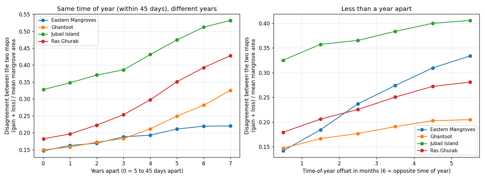

# Fusion window check

## What is a fusion window?

A map from one Sentinel-2 image is noisy. Haze, the tide, the sun angle and leftover cloud all move the mangrove
edges a little. So for each year we combine (fuse) the maps from several image dates into one map. The
**fusion window** is the set of dates we combine, for example the clear images from February to April.

## Why we checked it

The [first change maps](../RESULTS.md) combined March and November images in each year. If the window mixes dates
that look different, or is too long, the map can change just because of which dates went in, and that shows up as
change. So we asked three things:

1. How does map agreement depend on the time of year and on the number of years between dates?
2. Which way of combining the dates is the most repeatable?
3. What does the 2018 to 2025 change look like when both years use the same months?

## How we checked it

We selected clear Sentinel-2 images from 2018 to 2025, up to two per month, giving 135 to 150 dates at each of four
sites: Ghantoot, Eastern Mangroves, Ras Ghurab and Jubail Island. Each image was mapped with the random forest
trained with that whole site held out. We removed scenes flagged as hazy or less than half valid, and compared only
pixels valid on both dates.

We ran four checks:

1. **Compare dates.** For each pair of dates we measured the **disagreement**: the area mapped as mangrove on only one
   of the two dates, divided by the mean mapped mangrove area across the two dates. We kept pairs where at least 70%
   of the mangrove zone was valid on both dates. Pairs 5 to 45 days apart give a short-gap baseline. We compared that
   baseline with pairs from the same time of year (within 45 days) one or more years apart, and with pairs less than
   a year apart from opposite times of year. The baseline can include real change, so it is not a pure measure of
   noise.
2. **Separate window length from image count.** Around dates in 2020, we built composites from 1, 3, 5 or 7 images
   inside windows of 15 to 365 days. For each setting we compared two composites with no shared dates. This tests
   repeatability, and separates the benefit of more images from the effect of a longer time span. We compared a
   majority vote, the median and the mean of the mangrove probability, and a medoid (for each pixel, the date whose
   reflectance is closest to the others, which is then classified).
3. **Test the angle correction.** We corrected the reflectance for the sun and viewing angles with a BRDF c-factor,
   retrained the random forest with the same held-out sites, and compared corrected and uncorrected results.
   Changing the reference sun angle from 20° to 45° moved the 2018 to 2025 estimates by at most 0.4 percentage
   points.
4. **Rebuild the 2018 and 2025 maps.** We averaged the mangrove probability separately over February to April and
   over October to December in 2018 and in 2025, then applied the classification threshold to make each map. The
   two years were compared on one common valid footprint. Because 2018 has fewer images, we also repeated the
   comparison 50 times with the 2025 dates cut down to match the 2018 image count and time of year.

We measured repeatability separately from accuracy. Agreement with GMW was only a secondary check, because GMW also
supplied the training labels. The mapped gain and loss have not been checked against independent labels.

## What we found

- **Seasonal matching strongly affects map agreement.** Pairs from the same time of year one year apart disagree
  almost as little as the 5 to 45 day baseline. Pairs less than a year apart but from opposite times of year
  disagree more. At Eastern Mangroves the mapped area in February to April is about 10% lower than in October to
  December.
- **Maps from February to April and October to December of the same year show additional disagreement** at all
  four sites, compared with the baseline. The first change maps mixed March and November, so they include this. This test
  can't fully separate image artefacts from real seasonal changes in the mangroves.
- **Mean probability was the most repeatable method tested.** Averaging the forest's mangrove probability over the
  dates in the window was more repeatable than a majority vote or picking one typical image. In these tests, adding
  more images helped more than making the window longer.
- **Correcting for the sun and view angle (BRDF)** lowers the disagreement a little at every site.

| Site | 5 to 45 days apart | Same time of year, about 1 year apart | Opposite time of year, less than 1 year apart |
|---|---|---|---|
| Ghantoot | 0.15 | 0.16 | 0.21 |
| Eastern Mangroves | 0.14 | 0.16 | 0.33 |
| Ras Ghurab | 0.18 | 0.20 | 0.28 |
| Jubail Island | 0.32 | 0.35 | 0.40 |

Our candidate primary window, which has not been checked against independent labels, is the selected clear images from **February to
April**, averaged and compared with February to April of the other year. October to December is used as a second
check.

## 2018 to 2025 change with the same months in both years

| Site | Net change |
|---|---|
| Ghantoot | +8% to +17% |
| Ras Ghurab | +6% to +21% |
| Eastern Mangroves | -4% to +7% (could be either way) |
| Jubail Island | -4% to +29% (depends on the months used) |

These are sensitivity ranges from the reported season-matched endpoint experiments (February to April and October to
December), including the 5th to 95th percentile ranges from matched-date sampling. They describe the retained
comparison footprint and are not confidence intervals. Ghantoot and Ras Ghurab remain positive across these reported
results. The Ghantoot gain is smaller than the +25% from the first change maps. Al Aryam was left out because its
maps disagree too much even 5 to 45 days apart (0.65), and Al Nouf has only one chip.

## Limits

- This measures how repeatable the maps are, not how accurate. The change has not been checked against independent
  labels.
- 2018 only has 2 to 3 clear images in each window, so the 2018 map is the weak point.
- No tide matching, and not run on the locked test set.
