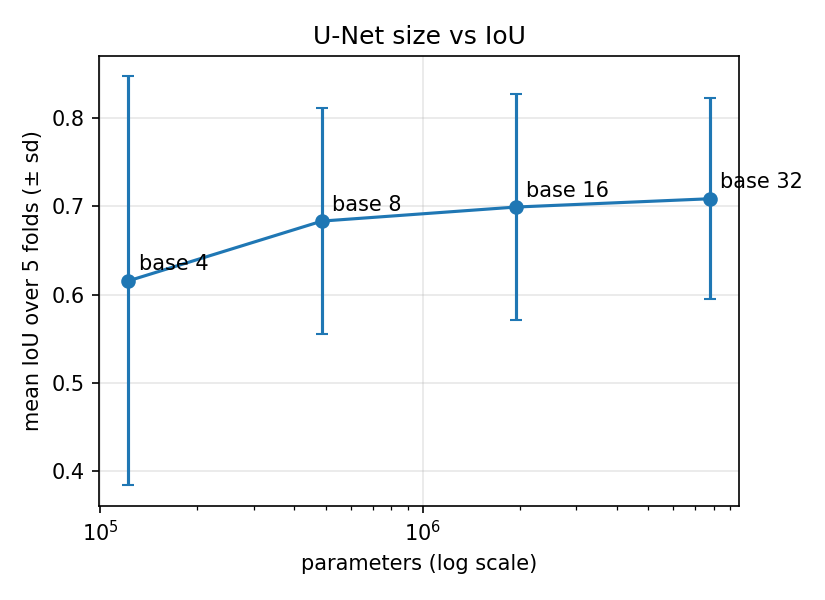

# Efficiency study: how small can the U-Net get?

The full U-Net has 7.8M parameters, but all our top models tie at about 0.70 IoU, so the big model might not be buying anything. A smaller model is cheaper to train and run and fits on smaller hardware, which matters if the change detection is going to be run again and again on new images. Here we shrink it by lowering the base width and keep everything else the same (same 5 folds, same chips, same training settings as the `gpu` preset, scored with `evaluate.py`). Code: `train_unet.py` presets `gpu_b16`, `gpu_b8`, `gpu_b4` and `efficiency.py`.

All four sizes were trained on the same GPU on the HPC (run by Zain with `efficiency.py`'s job script), so IoU, speed and memory can be compared directly. Base 8 and base 4 were also trained on a CPU first (`cpu_runs/`), and give the same IoU.

## Results

| Model | Parameters | Share | Mean IoU | Train min per fold | ms per chip | Peak GPU memory |
|---|---|---|---|---|---|---|
| U-Net base 32 (full) | 7,764,481 | 100% | 0.709 | 1.5 | 5.8 | 3,039 MB |
| U-Net base 16 | 1,943,297 | 25% | 0.699 | 1.0 | 4.0 | 1,510 MB |
| U-Net base 8 | 486,913 | 6.3% | 0.683 | 0.8 | 5.3 | 767 MB |
| U-Net base 4 | 122,273 | 1.6% | 0.616 | 0.7 | 3.8 | 401 MB |



Per fold:

| Fold | Held-out site | Base 32 | Base 16 | Base 8 | Base 4 |
|---|---|---|---|---|---|
| 1 | eastern mangroves | 0.854 | 0.857 | 0.855 | 0.850 |
| 2 | jubail island | 0.569 | 0.512 | 0.515 | 0.515 |
| 3 | ras ghurab | 0.700 | 0.700 | 0.681 | 0.698 |
| 4 | ghantoot | 0.784 | 0.767 | 0.745 | 0.752 |
| 5 | al aryam + al nouf | 0.635 | 0.660 | 0.620 | 0.263 |

## Paired test against the full model

Same fold-by-fold test as `results/mangrove_segmentation/model_comparison/` (all pairs in `pairwise.csv`).

| Full vs | Mean difference | 95% interval | Folds full wins | Clear? |
|---|---|---|---|---|
| Base 16 | 0.009 | -0.012 to 0.034 | 3 of 5 | no |
| Base 8 | 0.025 | 0.009 to 0.043 | 4 of 5 | no |
| Base 4 | 0.093 | 0.009 to 0.235 | 5 of 5 | yes |

## What it shows

- **Base 16 is as good as the full model** with a quarter of the parameters and half the GPU memory. It even beats it on 2 of the 5 folds.
- **Base 8 starts to cost a bit**, about 0.025 IoU. The full model wins 4 of 5 folds, so it's not a clear difference by our rule, but the interval is just above 0.
- **Base 4 is too small to train reliably.** On fold 5 it got stuck predicting no mangrove after epoch 4 and early stopping ended it at epoch 19, on both the GPU and the CPU run, so it's the size and not bad luck.
- **On a GPU, speed barely changes** (1.5 vs 0.8 minutes per fold, 4 to 6 ms per chip, since our chips are small). The real saving is memory, which halves every time the width halves. That's what matters for running on a laptop or a small device.
- So most of the full U-Net's parameters don't buy any IoU on our data. This fits the model comparison, where the top models all tie around 0.70 and the GMW labels look like the limit, not model size.

## Limits

- One training run per size. Retraining the full U-Net moved it by about 0.005 (0.709 here vs 0.704 committed), so gaps around 0.01 are noise.
- Speed numbers are for one GPU and small 256 x 256 chips. On a CPU the smaller models are much faster (see `cpu_runs/efficiency.csv`), but those weren't all run on the same CPU.
- Scores are against GMW, like every other model in the repo.

## Run it

```
cd src/mangrove_segmentation
python train_unet.py --preset gpu
python train_unet.py --preset gpu_b16
python train_unet.py --preset gpu_b8
python train_unet.py --preset gpu_b4
python efficiency.py --out ../../results/mangrove_segmentation/efficiency
```
