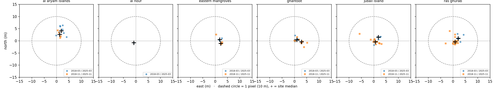

# Registration check without SIFT (phase correlation)

All our registration numbers so far came from SIFT landmarks. Zain's Eastern Mangroves write-up lists "whether a method that does not use SIFT would find the same shift" as unverified, so this checks it with a completely different method. Phase correlation compares whole 256 x 256 tiles in the frequency domain and finds the shift between them directly, no corners or matching. Code: `src/registration/phase_correlation_check.py`.

## Setup

- Same-season pairs at all 6 training sites: March 2018 vs March 2025 and November 2018 vs November 2025 (Al Nouf only has a March pair). These are the exact scenes Train_Val_Dataset was built from.
- Two runs: on the dataset chips (`per_chip.csv`, `summary.csv`), and on the full site images downloaded again with `collect.py` from the same scene ids (`full_sites/`). The chips only cover mangrove areas, so the full images give more tiles at the small sites. The full-site run is the main result.
- Per tile: near-infrared band (B08), Hann window, phase correlation to 1/100 pixel. Tiles with more than 5% cloud or no-data, or that are almost all water or all land, are skipped.
- Each tile is also done on the red band (B04), and it only counts if both bands agree within 2 m. This throws out tiles where the ground really changed (new canals at Jubail, moving sand bars) or where there's nothing to lock on to, since those give a random answer.
- Site number = median over its tiles, with a bootstrap interval over tiles. The shift is where 2025 sits relative to 2018 (east, north), same as the "whole-image shift" in the SIFT results.

## Result (full site images)

| Site | Pair | Tiles kept | East (m) | North (m) | Shift (m) | 95% interval | Pixels |
|---|---|---|---|---|---|---|---|
| Al Aryam Islands | Mar 2018 / Mar 2025 | 8 of 16 | 1.95 | 4.10 | 4.54 | 3.06 to 6.50 | 0.45 |
| Al Aryam Islands | Nov 2018 / Nov 2025 | 4 of 10 | 1.25 | 2.60 | 2.88 | 1.92 to 4.33 | 0.29 |
| Al Nouf | Mar 2018 / Mar 2025 | 1 of 1 | -0.80 | -0.80 | 1.13 | (1 tile) | 0.11 |
| Eastern Mangroves | Mar 2018 / Mar 2025 | 3 of 3 | 1.90 | 0.50 | 1.96 | 1.68 to 2.92 | 0.20 |
| Eastern Mangroves | Nov 2018 / Nov 2025 | 5 of 5 | 2.30 | -1.10 | 2.55 | 2.38 to 2.96 | 0.25 |
| Ghantoot | Mar 2018 / Mar 2025 | 10 of 11 | 1.00 | 0.40 | 1.08 | 0.45 to 1.58 | 0.11 |
| Ghantoot | Nov 2018 / Nov 2025 | 10 of 10 | 2.85 | -0.45 | 2.89 | 1.10 to 3.49 | 0.29 |
| Jubail Island | Mar 2018 / Mar 2025 | 5 of 14 | 1.90 | 1.50 | 2.42 | 1.70 to 3.28 | 0.24 |
| Jubail Island | Nov 2018 / Nov 2025 | 12 of 23 | 0.70 | -0.40 | 0.81 | 0.21 to 2.01 | 0.08 |
| Ras Ghurab | Mar 2018 / Mar 2025 | 6 of 8 | 2.15 | 1.00 | 2.37 | 2.01 to 4.22 | 0.24 |
| Ras Ghurab | Nov 2018 / Nov 2025 | 15 of 17 | 0.80 | -0.40 | 0.89 | 0.45 to 1.42 | 0.09 |



Every pair is under half a pixel (0.8 to 4.5 m). Ghantoot, Ras Ghurab, Al Aryam and Al Nouf had never been checked before. The chip-only run gives the same picture (`summary.csv`), just with fewer tiles at the small sites.

## Same answer as SIFT?

| | SIFT (earlier results) | Phase correlation |
|---|---|---|
| Eastern Mangroves, Nov 2018 vs Nov/Dec 2025 | 2.91 m, mostly east (2.5 to 3.3) | 2.55 m, mostly east (2.4 to 3.0) |
| Jubail, Nov/Dec pairs | 0.56 m and 1.01 m | 0.81 m |
| Jubail, March 2018 vs Jan/Mar 2025 | 2.34 m (different-tide check) | 2.42 m |

Yes. Two methods that share nothing (landmarks + RANSAC vs whole-tile frequency matching) land within about half a metre of each other. The SIFT dates aren't exactly the same as ours (Dec 2025 vs 16 Nov 2025 at Eastern), so a small gap is expected. So the "no correction needed" result doesn't depend on SIFT.

## Things we noticed

- Al Aryam March is the biggest shift, 4.5 m, mostly north. That's above the roughly 3.3 to 3.5 m where the SIFT script's rule would start applying a correction (see the Eastern Mangroves write-up), so Al Aryam is worth running through `real_raster_check.py` before using its change map. It was, and it does need a correction ([Al Aryam](../al_aryam/RESULTS.md)).
- March pairs come out a bit bigger than November pairs at most sites (about 2 to 2.5 m vs 0.8 to 2.9 m). We don't know why. Several of the 2018 and 2025 scenes come from different tiles (T40RBN vs T39RZH), which are in different UTM zones and get reprojected, which could add a small offset.

## Limits

- This measures one shift per tile. It can't see rotation or scale, but the SIFT runs already showed those are tiny.
- Tiles where the two bands disagree are dropped, so places that really changed are left out of the number. That's on purpose (they'd give a random shift) but it means the check only covers ground that stayed the same.
- Al Nouf has a single usable tile, so its number isn't worth much. Most of its area is open water.
- With 3 to 5 tiles at Eastern and Al Aryam November the intervals are rough.

## Run it

```
python src/registration/phase_correlation_check.py --train-val <Train_Val_Dataset> --out results/registration/phase_correlation
python src/mangrove_segmentation/collect.py --sites <sites.geojson> --scenes <scenes.csv> --out <dl>
python src/registration/phase_correlation_check.py --train-val <Train_Val_Dataset> --raw <dl>/raw --out results/registration/phase_correlation/full_sites
python -m pytest -q src/registration/tests
```

The sites file is the bounding box of each site's chips in `catalog.csv`, and the scenes file lists the scene ids from the same catalog (column `item_id`, split on `+`).
