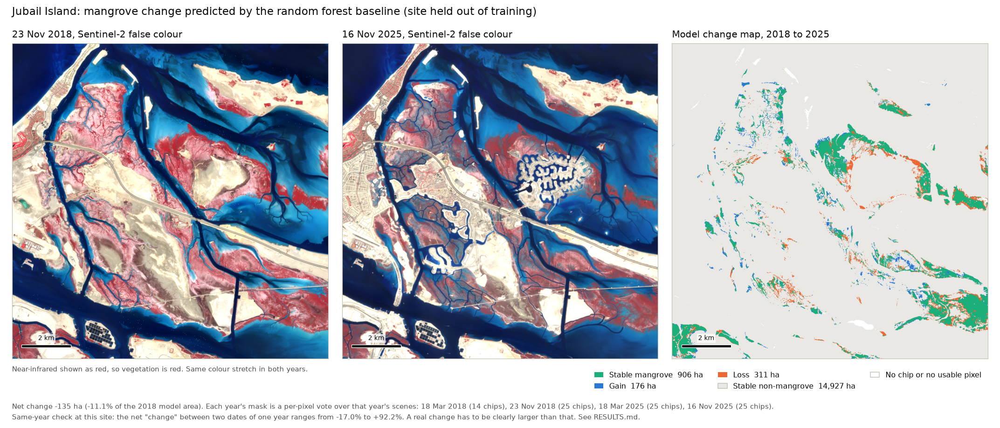

# Change detection

These scripts make the 2018 to 2025 mangrove change maps and check how much of the "change" is just noise
between image dates. Each site is predicted by a random forest that never saw it during training.



*Jubail Island: the 2018 and 2025 images, and the change map from a vote over each year's scenes. Green is stable mangrove, blue is gain, orange is loss.*

## Scripts

| Script | What it does | Results |
| --- | --- | --- |
| `inventory.py` | Lists which sites have chips in both years, which scenes are hazy and which labels exist | |
| `train_rf.py` | Trains the random forest with one site held out | |
| `change_map.py` | Predicts that site, builds the change map and draws the figure | [change maps](../../results/change_detection/RESULTS.md) |
| `noise_floor_all_sites.py` | Same-year check for every site: how much area "changes" between two dates of one year | [change maps](../../results/change_detection/RESULTS.md) |
| `new_bare_ground.py` | Maps land that turned into bare or built ground near the mangroves (band rule, no model) | [new bare ground](../../results/change_detection/human_activity/RESULTS.md) |
| [`date_effect/`](date_effect/README.md) | Why the mapped area changes with the image date (tide, image differences, model versions) | [date effect](../../results/change_detection/date_effect/RESULTS.md) |
| `common.py` | Shared helpers | |

The U-Net version of the same-year check is in [results/change_detection/unet](../../results/change_detection/unet/RESULTS.md), and the
fusion window check (which months to combine into one map) is in [results/change_detection/fusion_window](../../results/change_detection/fusion_window/RESULTS.md).

## Run it

From `src/change_detection`, on a CPU, a few minutes each. The Train/Val dataset (`catalog.csv`,
`hazy_scenes.csv`, `chips/`) is not in the repository.

```
python inventory.py             --train-val <Train_Val_Dataset> --out <output folder>
python train_rf.py              --train-val <Train_Val_Dataset> --out <output folder> --site jubail_island
python change_map.py            --train-val <Train_Val_Dataset> --out <output folder> --site jubail_island
python noise_floor_all_sites.py --train-val <Train_Val_Dataset> --out <output folder>
python new_bare_ground.py       --train-val <Train_Val_Dataset> --out <output folder> --sites ghantoot jubail_island
```

Keep the output folder outside the repository. It also gets the fitted forest and the map rasters, which must not
be committed.

The scripts import `baseline_rf.py` and `chipio.py` from `src/mangrove_segmentation` unchanged. `common.py` repeats
the one-fold steps of [`run_cv.py`](../mangrove_segmentation/supporting_scripts/baselines/run_cv.py), and each forest's
held-out IoU matches `results/mangrove_segmentation/baselines/cv_results.csv` to four decimals.
