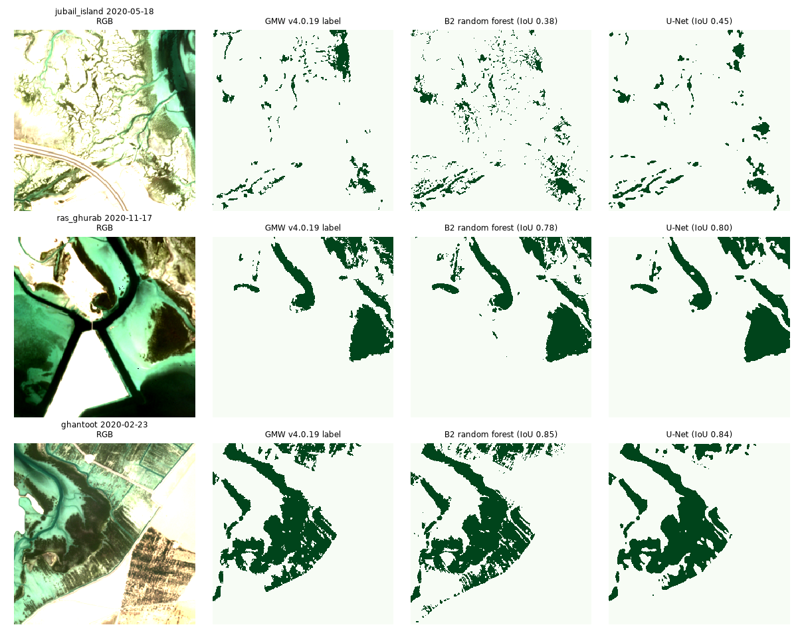

# Mangrove segmentation code

This folder makes the mangrove maps. It downloads Sentinel-2 images, cuts them into small 256 x 256 chips,
trains models to mark which pixels are mangrove, and scores them against the GMW map.



*Each row is one chip: the image, the GMW label, and what the random forest and U-Net predicted.*

## How it fits together

1. `collect.py` downloads the images.
2. `prepare.py` cuts them into chips and adds the GMW label.
3. `make_datasets.py` splits the chips into Train/Val and a locked Test set.
4. The model scripts train on Train/Val (each site is held out once).
5. `evaluate.py` scores every model the same way.

## Run it

```bash
conda env create -f environment.yml
conda activate mangrove
python run_all.py            # whole pipeline; see python run_all.py --help
```

Paths are set in `paths.py`. Tests: `pytest src/mangrove_segmentation/tests` from the repository root.

## Scripts

| Script | What it does | Results |
| --- | --- | --- |
| `baseline_ndvi.py` | NDVI rule (B1) | [baselines](../../results/mangrove_segmentation/baselines/RESULTS.md) |
| `baseline_rf.py` | Random forest (B2) | [baselines](../../results/mangrove_segmentation/baselines/RESULTS.md) |
| `baseline_svm.py` | SVM (B3) | [SVM](../../results/mangrove_segmentation/svm/RESULTS.md) |
| `train_unet.py` | U-Net | [U-Net](../../results/mangrove_segmentation/unet/RESULTS.md) |
| [`dinov3/`](dinov3) | DINOv3, frozen and LoRA | [DINOv3](../../results/mangrove_segmentation/dinov3/RESULTS.md) |
| `compare_models.py`, `model_size.py` | All models side by side | [comparison](../../results/mangrove_segmentation/model_comparison/RESULTS.md) |
| `confidence.py` | How sure the scores are | [confidence](../../results/mangrove_segmentation/confidence/RESULTS.md) |
| `date_stability.py`, `multi_date_vote.py` | Effect of the image date | [dates](../../results/mangrove_segmentation/date_stability/RESULTS.md), [vote](../../results/mangrove_segmentation/multi_date_vote/RESULTS.md) |
| `model_disagreement.py` | Where models and GMW disagree | [disagreement](../../results/mangrove_segmentation/model_disagreement/RESULTS.md) |
| `efficiency.py`, `rgb_only.py` | Smaller U-Nets, RGB-only models | [efficiency](../../results/mangrove_segmentation/efficiency/RESULTS.md), [RGB](../../results/mangrove_segmentation/rgb_only/RESULTS.md) |
| `label_agreement.py` | Hand labels vs GMW and models | [hand labels](../../results/mangrove_segmentation/hand_labels/RESULTS.md) |
| `final_test.py` | The one run on the locked test set | [final test](../../results/mangrove_segmentation/final_test/RESULTS.md), [plan](../../results/mangrove_segmentation/final_test/PLAN.md) |

Helpers: `paths.py`, `chipio.py`, `landcover.py`, `make_checksums.py` ([CHECKSUMS.md](CHECKSUMS.md)). Notes on the SVM: [SVM_BASELINE.md](SVM_BASELINE.md). Also [`notebooks/`](notebooks) (the same
steps as notebooks), [`supporting_scripts/`](supporting_scripts) (cross-validation runners) and [`tests/`](tests).

## Details

Click to open.

<details>
<summary>Downloading images (<code>collect.py</code>)</summary>

`sites.geojson` = lon/lat FeatureCollection, one feature per site with a `name` property.

```bash
# see which scenes it would pick (nothing downloaded)
python collect.py --sites sites.geojson --start 2020-01-01 --end 2020-12-31 --max-cloud 5 --per-site 0 --out data/ --dry-run

# download an exact, hand-picked list (recommended: pick dates per season yourself)
#   scenes.csv:  site,item_id
#                eastern_mangroves,S2A_T40RBN_20201117T070153_L2A
python collect.py --sites sites.geojson --scenes scenes.csv --out data/

# or let it take the N least-cloudy dates per site
python collect.py --sites sites.geojson --start 2025-10-01 --end 2025-12-31 --per-site 3 --out data/
```

`--per-site` picks the least-cloudy dates, which can all fall in one season. For season coverage, run it once per
season window, or write `scenes.csv` by hand from the `--dry-run` list. Re-runs skip files that already exist.

```
data/raw/<site>/<YYYY-MM-DD>.tif     7 bands, float32, NaN = no data
                                     1-6: B02 B03 B04 B08 B11 B12 surface reflectance (B11/B12 bilinear from 20 m)
                                     7:   SCL (nearest); cloud/shadow = classes 3, 8, 9, 10
data/raw_manifest.csv                site, date, item_id, tile, cloud_cover, processing_baseline,
                                     offset_applied, path, bounds_epsg32640, valid_fraction, masked_fraction
```

Size: about 8 MB per site-date for a 7 x 5.7 km site (721 x 568 px). Download time: a few seconds per scene.

**Sites on a tile edge.** Some sites sit where several MGRS tiles meet (e.g. `al_aryam_islands`, at the corner of 39QZG, 39RZH, 40QBM and
40RBN), so no single item covers them. In `--scenes` mode, list every item of the same acquisition date on its own
row with the same site name; `collect.py` groups rows by (site, date) and mosaics them. Each pixel comes from the
first listed item that has valid data there, and each item's own scale/offset is applied to its own pixels, once.
The manifest's `item_id` and `tile` then hold the item ids / tiles joined with `+`. A single item per row works as
before.

</details>

<details>
<summary>Reflectance offset (read before changing <code>collect.py</code>)</summary>

Earth Search Collection-1 files store raw numbers (DN). Every scene, including 2018 and 2020 (reprocessed as
baseline 05.00), carries ESA's offset, and each file's STAC metadata says so: `scale 0.0001, offset -0.1`.
`collect.py` reads those two numbers per band and applies **reflectance = DN x 0.0001 - 0.1 exactly once**.
The manifest's `offset_applied` column records it.

- Do **not** subtract 0.1 again later, and do **not** clip negatives to 0. Dark water legitimately comes out
  slightly below 0 (around 14% of B04 pixels in the 2020 test scene). Clipping makes NDVI = 1 over water.
- The GEE harmonized collection is already shifted, so there it is DN / 10000 with no extra offset.
- Earlier team data that used `DN / 10000` on Earth Search C1 files was **0.1 too bright**.

</details>

<details>
<summary>Test run, 23 Oct 2026</summary>

Eastern Mangroves AOI 54.40-54.47E, 24.43-24.48N, tile 40RBN, two November scenes:

| Date | Scene | Water B04 median | Vegetation B08 / B04 median | Vegetation NDVI median |
| --- | --- | --- | --- | --- |
| 2020-11-17 | S2A_T40RBN_20201117T070153_L2A | 0.009 | 0.254 / 0.026 | 0.82 |
| 2025-11-20 | S2A_T40RBN_20251120T065320_L2A | 0.049 | 0.238 / 0.064 | 0.57 |

Water and vegetation are both in the expected ranges. 2025 is brighter in the red band on the same month,
probably haze, so NDVI thresholds will not transfer between dates. Normalise per scene, or let models learn it.
There are 25 scenes under 2% cloud in 2020 alone for this site, so imagery is not a limit.

</details>

<details>
<summary>Making chips (<code>prepare.py</code>)</summary>

Turns the per-site/date GeoTIFFs from `collect.py` into 256 x 256 training chips that every model reads.

```bash
pip install rasterio numpy matplotlib
python prepare.py --manifest data/raw_manifest.csv --sites sites/sites.geojson --labels labels/ --out data/
```

What it does, per raw file:
1. Warps the GMW labels onto the scene's exact grid (EPSG:32640, 10 m, nearest neighbour), as two bands so the
   team can choose later: `label_v4019` (GMW v4.0.19, 10 m, 2020 scenes only) and `label_v4112` (GMW v4.1.12,
   ~30 m, same year as the scene for 2018 / 2020 / 2025). 255 = no label for that year.
2. Cloud/shadow mask from SCL classes 3, 8, 9, 10; adds NDVI and MNDWI = (B03 - B11) / (B03 + B11).
   Index denominators are floored at 0.01 and clipped to [-1, 1]; reflectance itself is never clipped.
3. Cuts non-overlapping 256 x 256 chips; drops chips > 5% cloud/shadow or > 10% no-data; keeps every chip with
   >= 1% mangrove under either label plus background-only chips up to 20% of the kept total per site (seed 42).
4. Split comes from the site's `proposed_split` in `sites.geojson` (override with `--split-override site=split`).

Outputs:

```
<out>/chips/<site>_<date>_r<row>_c<col>.npz
      image        float32 [8,256,256]  B02 B03 B04 B08 B11 B12 NDVI MNDWI (NaN = no data)
      label_v4019  uint8   [256,256]    1 mangrove, 0 not, 255 no label
      label_v4112  uint8   [256,256]    same coding
      cloud, nodata bool   [256,256]
      transform    float64 [6]          chip affine in EPSG:32640
<out>/catalog.csv   chip_id, site, date, year, split, row, col, bounds, cloud_pct, nodata_pct,
                    mangrove_pct_v4019, mangrove_pct_v4112, kind, offset_applied, item_id, source_file, path
<out>/norm.json     per-channel mean/std from TRAIN chips only (valid, cloud-free pixels)
<out>/qa/<site>_samples.png   6 random chips: RGB, NDVI, both labels
<out>/qa/<site>_hist.png      band histograms per date; water should sit at 0.00-0.03, not 0.10+
```

Loading a chip:

```python
d = np.load("data/chips/<chip_id>.npz")
x = (d["image"] - mean[:, None, None]) / std[:, None, None]   # from norm.json
y = d["label_v4112"]; valid = (y != 255) & ~d["nodata"] & ~d["cloud"]   # train only on valid pixels
```

Notes: chips are cut on a grid starting at the raster's top-left corner, so a narrow site gives few chips; the
same place appears once per date (all dates of a site share its split, so this does not leak). Tested 23 Oct on
Eastern Mangroves 2020-11-17 and 2025-11-20: 8 chips, ~3 s, ~1.3 MB per chip.

</details>

<details>
<summary>Scoring and baselines (<code>evaluate.py</code>)</summary>

Every model is scored by the same script, against the same frozen split. Files: `evaluate.py`, `baseline_ndvi.py` (B1),
`baseline_rf.py` (B2), `chipio.py` (shared chip loading), `tests/test_evaluate.py`.

```bash
pip install numpy pandas scikit-learn joblib rasterio pytest

# B1: NDVI > t AND MNDWI < w. t and w are grid-searched on VALIDATION chips only.
python baseline_ndvi.py fit     --catalog data/catalog.csv --chips data --label v4019 --out models/ndvi.json
python baseline_ndvi.py predict --catalog data/catalog.csv --chips data --model models/ndvi.json --split test --pred-out preds/ndvi

# B2: per-pixel random forest, 200k class-balanced TRAIN pixels; depth/leaf and probability threshold picked on VALIDATION
python baseline_rf.py fit     --catalog data/catalog.csv --chips data --label v4019 --out models/rf.joblib
python baseline_rf.py predict --catalog data/catalog.csv --chips data --model models/rf.joblib --split test --pred-out preds/rf

# Score one model (writes results.json, results.md, per_chip.csv)
python evaluate.py --pred preds/ndvi --catalog data/catalog.csv --chips data --split test --label v4019 --name "B1 NDVI" --out results/ndvi

# Put several models side by side
python evaluate.py --compare results/ndvi/results.json results/rf/results.json --out results/comparison.md
```

**Your model's predictions:** one binary mask per chip, named `<chip_id>.npy`, `.npz` (key `mask`) or `.tif`, same
256 × 256 grid as the chip. 1 = mangrove.

**What is counted:**
- Only usable pixels count: finite in every band, not cloud, not no-data, and label ≠ 255.
- `--label v4019` (10 m, 2020 only) skips 2018 and 2025 chips automatically; they are listed in `chips_skipped_no_label`.
- `--label v4112` (~30 m, 2018/2020/2025) scores every year.
- Metrics are for the mangrove class, pixel-pooled per site and over all chips: IoU, F1, precision, recall.
- 95% CI = bootstrap over chips: 1000 resamples, seed 0, so the CI is identical on every rerun.

**Rules:**
- Choose thresholds and settings on `--split val` only.
- Run `--split test` once per final model.
- `--split external` gives the generalisation score.

`--chips` accepts either the prepare.py output folder or its `chips/` subfolder.

</details>
