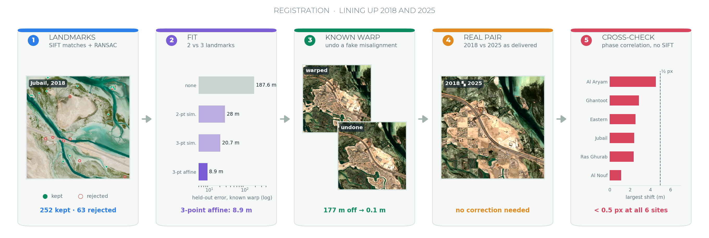

# Registration

Before two years can be compared, the 2018 and 2025 images have to line up, so that the same pixel is the same spot on the ground. If 2025 is off by even one pixel (10 m), every mangrove edge and shoreline shows up as fake change. This folder finds landmarks that appear in both images, fits a transform from them, measures how far off the images still are, and checks the answer with a second method that does not use landmarks.

**Landmark detection:** Khaled Alzaabi 
**Alignment, error measurement and the phase correlation check:** Tehsin Shaik

  

## How it works

1. **Landmarks.** SIFT finds corners in both images, skipping the inside of open water. A match is kept only if it is clearly better than the next best and both points pick each other. RANSAC then drops matches that don't agree with one common transform, such as buildings that were built or demolished between 2018 and 2025.
2. **Fit.** From the landmarks we fit either a similarity (shift, rotation and one scale, which 2 landmarks are enough for) or a full affine (also shear and separate x and y scale, which needs 3 landmarks not on a line). The error is measured in metres (EPSG:32640) and always on landmarks that were not used for the fit.
3. **Known-warp test.** The real images turned out to be aligned already, so we move the 2025 image by a known random affine and check that the method undoes it.
4. **Real pair.** A fitted transform is only applied if it lowers the held-out error by at least 1 m compared with no correction. Otherwise the 2025 image is left as it is.
5. **Cross-check.** Phase correlation compares whole 256 × 256 tiles in the frequency domain and finds the shift between them directly, with no landmarks, at all 6 training sites.

## Results

| | Result | Details |
| --- | --- | --- |
| **Landmarks** | SIFT with open water skipped is the most reliable detector, with a worst error of 0.18 px over 20 known-warp trials. Keeping only built-up ground, the usual rule, is the worst, because that is the land that changed. | [Landmark detection](../../docs/LANDMARK_DETECTION.md) |
| **2 vs 3 landmarks** | On a known warp, 3 landmarks with a full affine give a median error of 8.9 m, against 28.0 m with 2 landmarks. Nearly straight triplets can be off by kilometres. | [Method](../../docs/REGISTRATION_METHOD.md) |
| **Known warp** | On the real 6-band images, warps of 151 to 236 m are undone to within 0.11 to 0.16 m. | [Method](../../docs/REGISTRATION_METHOD.md#check-on-the-real-6-band-images) |
| **Real pairs** | At Jubail and Eastern Mangroves the held-out error is about half a pixel (4.8 to 5.8 m) and no fitted model beats no correction, so none is applied. The same holds at different tides, with fewer landmarks. | [Eastern Mangroves](../../results/registration/eastern_mangroves/RESULTS.md) · [different tides](../../results/registration/different_tides/RESULTS.md) |
| **Cross-check** | Phase correlation finds shifts of 0.8 to 4.5 m at all 6 sites, within about 0.5 m of SIFT where both were run. Al Aryam in March (4.5 m) is the largest. | [Phase correlation](../../results/registration/phase_correlation/RESULTS.md) |
| **Al Aryam** | The one site that needs a correction: 2025 is about 5 m north of 2018, and a shift lowers the held-out error by 2.1 m in March and 1.3 m in November. Shifting the 2025 chips removes about 3 ha of fake gain, and the change still doesn't beat the same-year noise. | [Al Aryam](../../results/registration/al_aryam/RESULTS.md) |

## Code

| File | What it does |
| --- | --- |
| `landmarks.py` | Finds and matches landmarks, compares detectors and filters |
| `figures.py` | Landmark and checkerboard figures |
| `affine_alignment.py` | Fits similarity and affine transforms, runs the 2 vs 3 experiment, warps a GeoTIFF |
| `real_raster_check.py` | Full check on a real 2018/2025 pair |
| `phase_correlation_check.py` | Shift per tile, without SIFT |
| `make_6band_copy.py` | Makes 6-band copies of downloads for the real-pair check |
| `tide_scene_scan.py` | Finds 2018 and 2025 scenes with different water levels |
| `tide_landmark_zones.py` | Splits landmarks into dry land and shoreline |
| `shift_chips.py` | Copies the dataset with one site's chips moved by a fitted shift |
| `tests/` | Run with `pytest src/registration/tests` |

How to run each script is at the end of its write-up.
